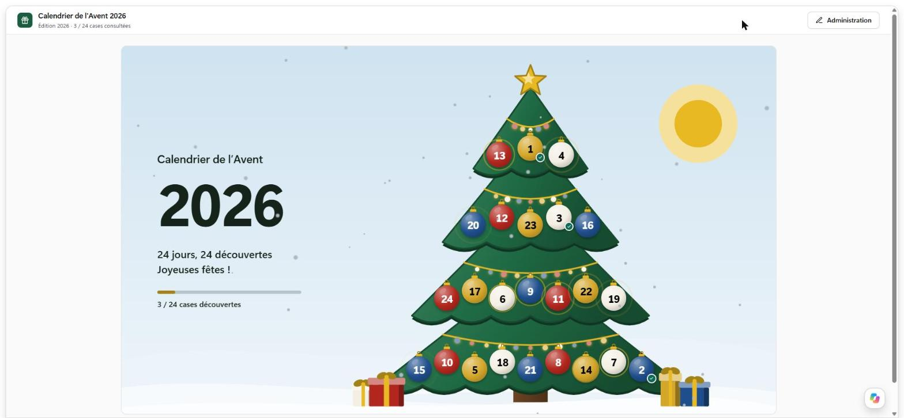
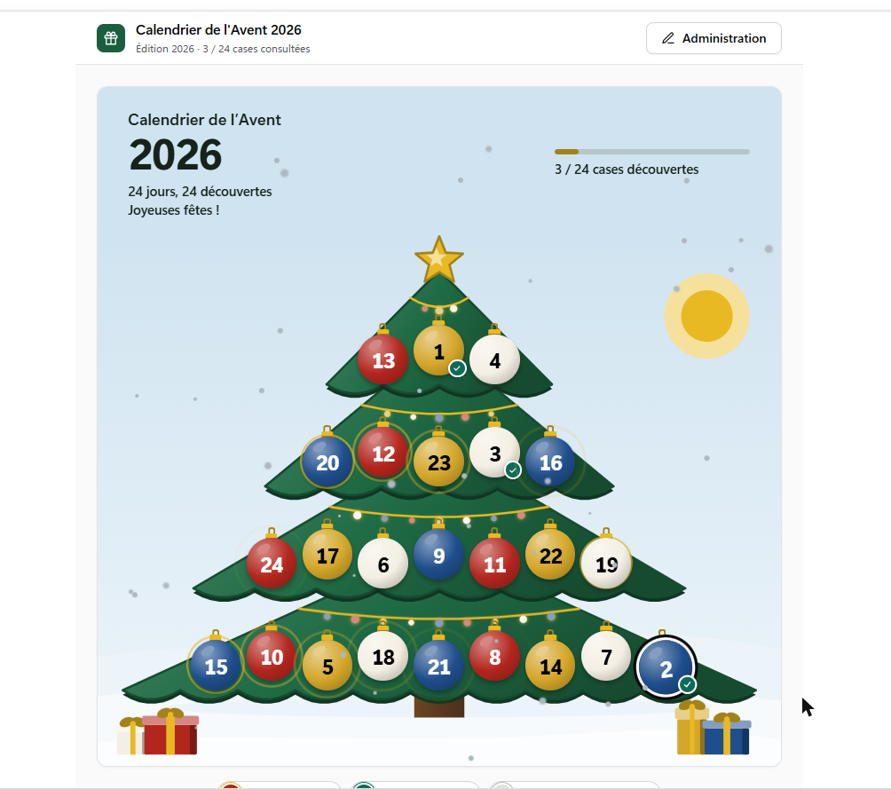
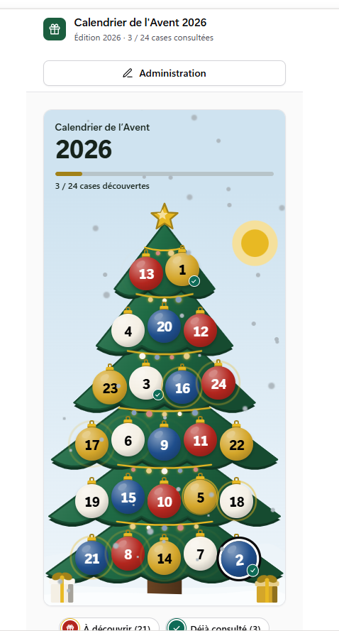
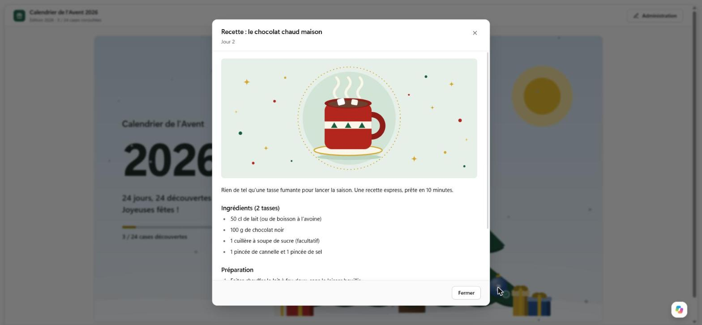
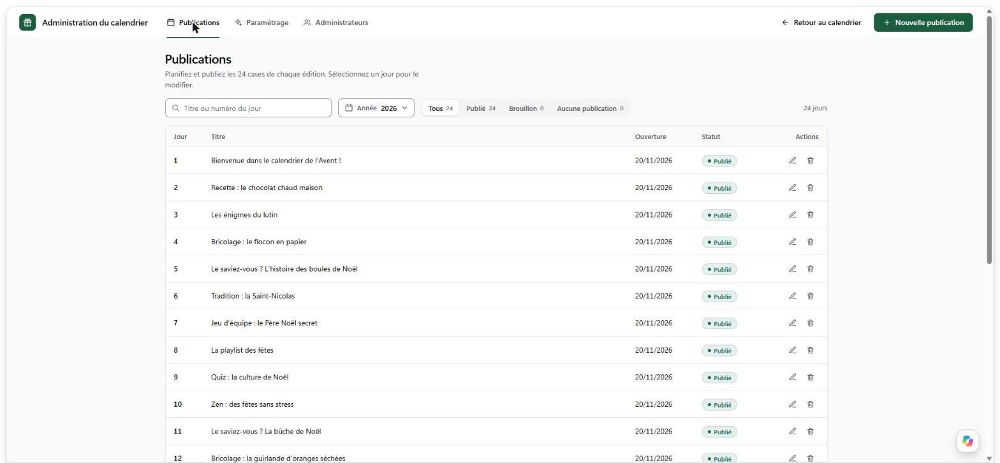
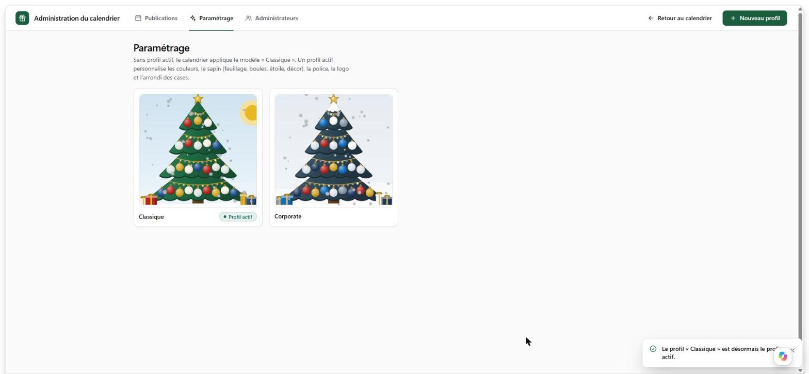
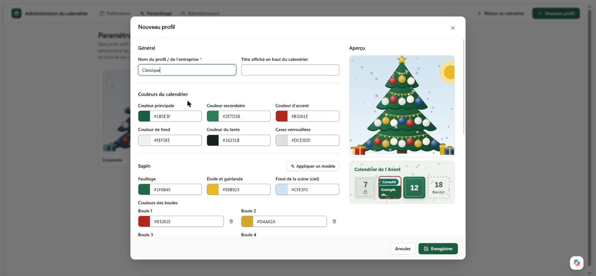

# Advent Calendar for SharePoint Online

A ready-to-deploy **Advent calendar web part** for any SharePoint Online intranet: 24 doors that unlock day after day from December 1 to 24, a built-in administration screen, and SharePoint lists that create themselves.




> Screenshots show the French UI; the app is also available in English.

🇫🇷 [Version française](#-version-française) · 📘 [Full guide (EN)](docs/GUIDE.en.md) · 📗 [Guide complet (FR)](docs/GUIDE.fr.md)

---

## Contents

- [Why this web part](#why-this-web-part)
- [Screenshots](#screenshots)
- [Quick start](#quick-start)
- [Prerequisites](#prerequisites)
- [Clone and build](#clone-and-build)
- [Deploy to SharePoint](#deploy-to-sharepoint)
- [What gets created](#what-gets-created)
- [First steps](#first-steps)
- [Languages](#languages)
- [Security and privacy](#security-and-privacy)
- [Known limitations](#known-limitations)
- [Project structure](#project-structure)
- [Development](#development)
- [Contributing](#contributing)
- [Author](#author)
- [License](#license)
- [🇫🇷 Version française](#-version-française)

## Why this web part

- **Zero manual setup.** Adding the app to a site creates the four lists it needs; the web part then checks and repairs them on load.
- **Content from day one.** 24 sample posts (traditions, recipes, crafts, riddles, quizzes, team games…), each with its own illustration, are built into the package and displayed until you publish your own.
- **Built-in administration.** Posts (rich text editor, images, links, drafts, custom opening dates), theme profiles with live preview, administrators and one-click list security, all inside the web part.
- **Two layouts.** An illustrated Christmas tree that adapts to the web part width (wide, tablet, phone portrait), or a grid of doors with a 3D opening animation.
- **Your look, not ours.** 6 theme templates (Classic, Nordic, Starry night, Frosted pastel, Corporate, Chalet), then colors, tree, baubles, scenery, font, logo and snow to match your organization.
- **Bilingual.** English and French interface and demo content, following each user's SharePoint display language.
- **Lightweight and self-contained.** React 17, PnPjs v4 and DOMPurify only: no UI library, no external CDN, system font, no API permission to approve.

## Screenshots

<table>
  <tr>
    <td width="60%"></td>
    <td width="22%"></td>
    <td width="18%"></td>
  </tr>
  <tr>
    <td align="center">Desktop</td>
    <td align="center">Tablet</td>
    <td align="center">Phone</td>
  </tr>
</table>

| Opening a door | Administration: posts |
|---|---|
|  |  |
| **Theme profiles** | **Theme editor** |
|  |  |

More screenshots (post form, templates, branding, administrators) are in the [full guide](docs/GUIDE.en.md).

## Quick start

### Option A: deploy the ready-made package

No tools to install. Download `advent-calendar.sppkg` from the [latest release](https://github.com/AhmMZQ-m365/advent-calendar/releases/latest) (the same package is also versioned in this repository at `sharepoint/solution/advent-calendar.sppkg`), then go straight to [Deploy to SharePoint](#deploy-to-sharepoint).

### Option B: build from source

```bash
git clone https://github.com/AhmMZQ-m365/advent-calendar.git
cd advent-calendar
nvm use 22          # Node.js 22 LTS
npm ci
npm run build       # -> sharepoint/solution/advent-calendar.sppkg
```

Details in [Clone and build](#clone-and-build).

## Prerequisites

| To | You need |
|---|---|
| Deploy the package | SharePoint Online, and the right to upload apps to the **tenant app catalog** or to a **site collection app catalog** |
| Add the app to a site | Site owner of that site |
| Build from source | **Node.js 22 LTS** (`>=22.14.0 <23.0.0`, enforced by `engines` in `package.json`) and npm (shipped with Node.js) |
| Run the optional seed script | PowerShell 7.4+, the [PnP.PowerShell](https://pnp.github.io/powershell/) 3.x module and a Microsoft Entra ID app registration (ClientId) for PnP PowerShell |

**Managing several Node.js versions.** Other SPFx projects often need another Node.js version. Use [nvm-windows](https://github.com/coreybutler/nvm-windows) on Windows or [nvm](https://github.com/nvm-sh/nvm) on macOS / Linux:

```bash
nvm install 22
nvm use 22
node --version      # v22.x
```

**What you do NOT need.**

- **No gulp.** Since SPFx 1.22, the build toolchain is **Heft**, run through the npm scripts of the project (`npm run build`, `npm start`…). Gulp is not used and no global build tool is required.
- **No Yeoman.** `yo` and `@microsoft/generator-sharepoint` are only needed to *create* your own SPFx projects (`npm install -g yo @microsoft/generator-sharepoint`). They are not needed to build or deploy this one.

## Clone and build

1. Clone the repository (or your fork) and open the folder:

   ```bash
   git clone https://github.com/AhmMZQ-m365/advent-calendar.git
   cd advent-calendar
   ```

2. Switch to Node.js 22: `nvm use 22`.
3. Install the exact dependency versions from `package-lock.json`:

   ```bash
   npm ci
   ```

4. Build the production package:

   ```bash
   npm run build
   ```

   This checks the localized strings (`npm run loc`), compiles, lints, runs the tests and bundles (`heft test --clean --production`), then packages (`heft package-solution --production`). The result is **`sharepoint/solution/advent-calendar.sppkg`**.

5. Optional, to run the web part from your machine while developing, see [Development](#development).

## Deploy to SharePoint

1. **Upload the package to an app catalog.**
   - *Tenant app catalog*: SharePoint admin center › **More features** › **Apps** › **Open**, then upload `advent-calendar.sppkg` and confirm the deployment dialog.
   - *Site collection app catalog*: upload the package to the **Apps for SharePoint** library of that site collection (a SharePoint administrator creates the catalog once, for example with `Add-SPOSiteCollectionAppCatalog -Site <site-url>`).

   The package requests **no API permission**, so there is nothing to approve in *API access*.

2. **Add the app to each site** that will host a calendar: **Site contents › New › App**, then pick **Advent Calendar**. Deployment is site by site (`skipFeatureDeployment: false`): adding the app activates a feature that creates the [four lists](#what-gets-created), **empty**.

3. **Add the web part to a page**: edit a page, open the toolbox and add **Advent Calendar** (category *Advanced*). It can be placed in a full-width section.

4. **Open the page as a site owner.** On load, the web part checks the lists and repairs what is missing (lists, columns, indexes, validation formulas), applies item-level security to the *Visits* list (each user only sees their own rows, attachments disabled, Edit / Design permission levels lowered to Contribute), and sets the English and French titles of the lists and columns. Repairs need the *Manage Lists* permission, the *Visits* list security needs *Manage Permissions*, and the titles are translated by site owners. If a required list or column is missing, readers see a message asking a site owner to open the page.

5. **Rename the lists if you like.** Lists are identified by their **URL**, never by their title.

## What gets created

| List (URL) | Title (English / French) | Role | Main columns (internal names) |
|---|---|---|---|
| `Lists/AdventPublications` | Advent Calendar – Posts / Calendrier de l'Avent – Publications | One post per day and per edition | `Title`, `AdvDay` (1–24), `AdvYear`, `AdvUnlockDate`, `AdvImage`, `AdvBody` (rich text), `AdvLink`, `AdvPublished`, `AdvKey` (hidden, `YYYY-DD`, unique) |
| `Lists/AdventSettings` | Advent Calendar – Settings / Calendrier de l'Avent – Paramétrage | Theme profiles | `Title`, `AdvIsActive`, 6 calendar colors (`AdvPrimaryColor` … `AdvLockedColor`), tree (`AdvTreeColor`, `AdvBaubleColors`, `AdvStarColor`, `AdvSceneBackground`, `AdvSceneStyle`, `AdvGarlandLights`), `AdvFontFamily`, `AdvFontUrl`, `AdvLogo`, `AdvHeaderTitle`, `AdvBorderRadius` (0–32 px), `AdvSnowEffect` |
| `Lists/AdventAdmins` | Advent Calendar – Administrators / Calendrier de l'Avent – Administrateurs | Calendar administrators | `Title`, `AdvAdminUser` (person, users only) |
| `Lists/AdventViews` | Advent Calendar – Visits / Calendrier de l'Avent – Consultations | Doors opened by each user (one row per user and per edition) | `Title`, `AdvYear`, `AdvViewedCount`, `AdvViewedDays` (JSON), `AdvViewKey` (hidden); user = *Created By* |

**Multilingual titles.** The feature creates the lists, columns and content types with French titles. The first time a site owner opens the page, the web part adds the English titles as SharePoint multilingual resources (`TitleResource` of lists and columns, `NameResource` of content types, set with `SetValueForUICulture` for `fr-FR` and `en-US`; on a site whose default language is neither, the default value gets the English title). Users then see the titles in their display language, provided the site offers it. A title is only translated while it still has its original French or English value: **titles renamed by an administrator are never overwritten**. The English and French titles are defined once, in `models/listDefinitions.ts`.

The app also writes images to the **Site Assets** library: `AdventCalendar` (images and logos uploaded from the administration screen) and `AdventCalendarDemo` (illustrations of the imported demo content).

## First steps

1. **Add the web part** to a page (see above) and publish the page. Until you publish your own posts, readers see the 24 built-in demo doors. Drafts do not count: prepare your posts as drafts, the demo stays visible until the first one of the edition is published.
2. **Secure the lists** (recommended right after installation): **Administration › Administrators › Secure the lists**. Without it, any site member can edit the calendar lists directly.
3. **Add administrators** in the same tab. Site owners are always administrators; add other people (users only, not groups) who will manage the posts.
4. **Choose a look**: **Administration › Settings › New profile**, pick a template, adjust it, save, then **Set as active**. Without an active profile, the *Classic* template applies.
5. **Make the content yours**: **Administration › Posts › Import the demo content** copies the 24 sample posts into the list and their illustrations into *Site Assets › AdventCalendarDemo*. Edit, replace or delete them, or create your own posts with **New post**.
6. **Preview before December**: edit the page, open the web part properties, turn on **Test mode: simulate today's date** and enter a **Simulated date** such as `2026-12-24`. It only applies while the page is in edit mode; readers always see the real date.
7. **After Christmas, nothing to do**: with *Edition (year)* empty, the calendar shows the current year in November and December and the previous year from January to October, so the season that has just ended stays available (every door open) until the next one starts. From September, **Administration › Posts** opens on the upcoming edition.

The [full guide](docs/GUIDE.en.md) covers every screen, field and setting.

## Languages

The interface, the date formats and the demo content are available in **English** and **French**. SharePoint Framework loads the strings that exactly match the user's SharePoint display language: **`fr-FR` gets French, every other language gets English** (including `fr-CA` and `fr-BE`; adding a `loc/fr-ca.js` file would support them). The display language comes from the user's Microsoft 365 language settings, provided the site offers that language (site default language or an alternate language in *Site settings › Language settings*). List titles and column names follow the same language (see [What gets created](#what-gets-created)). See the [guide](docs/GUIDE.en.md#9-languages) for details.

## Security and privacy

- **Hiding is not protecting.** Only administrators see the *Administration* button, but until you click **Secure the lists**, any member can edit the lists through SharePoint or its REST API. Securing breaks inheritance on the three content lists: owners = *Full Control*, listed administrators = *Contribute*, members and visitors = *Read*.
- **HTML is sanitized** with DOMPurify when saved and when displayed: scripts, forms, iframes, `style`, `class` and `id` attributes are removed, and links open in a new tab with `rel="noopener noreferrer"`. Image, link and logo URLs must be `http(s)`; font files must be HTTPS.
- **No third-party code at runtime**: no external CDN, no tracking, no API permission requested.
- **Personal data.** The *Visits* list stores which doors each user opened and when. Each user only sees their own rows, but site owners (Full Control) and site collection administrators can read all of them. Inform your users according to your data protection policy (GDPR or equivalent).

## Known limitations

- **Locking is visual, not an embargo.** Future posts and drafts sit in a list that every reader can query through the SharePoint REST API. Never put confidential content in the calendar before its date.
- **One calendar content per site.** All web parts on a site share the same lists; use the *Edition (year)* and *Theme profile* properties to vary them, or another site for separate content.
- **Full screen relies on undocumented page elements.** If SharePoint changes them, the page simply keeps its usual chrome. Add `?chrome=1` to the page URL to disable full screen.
- **Demo images and the Office 365 CDN.** If the CDN blocks the cross-origin download, the demo import creates the posts without images and shows a warning (see [troubleshooting](docs/GUIDE.en.md#11-troubleshooting)).
- **French variants other than `fr-FR`** get the English interface until a matching loc file is added.

## Project structure

```
config/                     SPFx configuration (package-solution.json: feature that creates the lists)
sharepoint/assets/          elements.xml (site columns, content types, list instances) + schema-*.xml
sharepoint/solution/        advent-calendar.sppkg (ready-to-deploy package)
scripts/
  seed-demo.ps1             optional PnP PowerShell script: demo posts, illustrations, Classic profile
  sync-loc.js               strings check and typing (npm run loc)
docs/                       user guides (EN, FR) and screenshots
src/webparts/adventCalendar/
  AdventCalendarWebPart.ts  web part: PnPjs setup, property pane, language, full screen
  loc/                      en-us.js and fr-fr.js (strings), mystrings.d.ts (generated)
  components/calendar/      reader screen: tree, door grid, pop-up, legend, snow
  components/admin/         administration screen (lazy-loaded)
  components/common/        header, dialogs, inputs, toasts…
  services/                 SharePoint services (provisioning, posts, settings, admins, security, views…)
  defaults/                 demo content, theme templates, tree geometry
  assets/demo/              demo illustrations (day-01.svg … day-24.svg)
  models/                   types and list definitions
  theme/                    design tokens, global and responsive CSS, icons
```

## Development

| Script | Effect |
|---|---|
| `npm run build` | `npm run loc`, then `heft test --clean --production` and `heft package-solution --production` → `sharepoint/solution/advent-calendar.sppkg` |
| `npm start` | `npm run loc`, then `heft start --clean`: serves the web part from `https://localhost:4321` for debugging |
| `npm run bundle` | `npm run loc`, then `heft build --clean --production` (production bundle, no package) |
| `npm run package-solution` | `heft package-solution --production` (packages the last bundle) |
| `npm run loc` | Fails if `en-us.js` and `fr-fr.js` do not have exactly the same keys, or if the code uses a missing key; generates `mystrings.d.ts`; reports unused keys |
| `npm run clean` | `heft clean` |

**Debugging on a SharePoint page.** The SharePoint Online workbench (`/_layouts/workbench.aspx`) is deprecated since May 13, 2026 and retired on December 1, 2026: as Microsoft recommends, the web part is debugged on a real modern page, with the SharePoint Framework debug toolbar.

1. Once per workstation, trust the development certificate: `npx heft trust-dev-cert`.
2. On a **development** site (not production), create a modern page that you can edit.
3. In `config/serve.json`, replace the two placeholders of `initialPage` with the path of that page:

   ```json
   "initialPage": "https://{tenantDomain}/sites/YOUR-DEV-SITE/SitePages/YOUR-TEST-PAGE.aspx?loadSPFX=true&debugManifestsFile=https://localhost:4321/temp/build/manifests.js"
   ```

4. Set your tenant domain, which replaces `{tenantDomain}` (shared by all your SPFx projects):

   ```powershell
   $env:SPFX_SERVE_TENANT_DOMAIN = "contoso.sharepoint.com"      # PowerShell
   ```

   ```bash
   export SPFX_SERVE_TENANT_DOMAIN="contoso.sharepoint.com"      # bash / zsh
   ```

5. Run `npm start`. The browser opens the page with the debug parameters: accept **Load debug scripts** (and, in Edge or Chrome 142+, allow access to the local network), edit the page and add **Advent Calendar** from the toolbox. Changes are rebuilt on save; reload the page to see them.

To start the server without opening a browser, run `npm start -- --nobrowser`, then add `?loadSPFX=true&debugManifestsFile=https://localhost:4321/temp/build/manifests.js` to the URL of any modern page. **Stop** on the debug toolbar, or `&reset=true` in the URL, turns debug scripts off. Read-mode full screen is disabled while the web part is served from `localhost`.

See [Debug SharePoint Framework solutions on modern SharePoint pages](https://learn.microsoft.com/sharepoint/dev/spfx/debug-modern-pages) and [Set up your SharePoint Framework development environment](https://learn.microsoft.com/sharepoint/dev/spfx/set-up-your-development-environment).

**Conventions.**

- **No UI library.** Native HTML and CSS only, with a design inspired by shadcn/ui and no dependency: tokens in `theme/tokens.ts`, `ac-*` classes in `theme/globalStyles.ts`, icons in `theme/Icons.tsx`. Fluent UI v9 shares a global keyboard-navigation instance with the SharePoint page and can break pages created from templates.
- **No CDN.** Every dependency is bundled; PnPjs imports are centralized in `services/pnp.ts`.
- **Strings in both languages.** Every UI string lives in `loc/en-us.js` **and** `loc/fr-fr.js`; the build fails if the keys differ.
- **Schema changes in two places**: `sharepoint/assets/elements.xml` (new sites) and `models/listDefinitions.ts` (self-repair of existing sites). Never change existing GUIDs, list URLs or internal column names.
- Strict TypeScript (no `any`); the build must end with no errors and no warnings.

## Contributing

Issues and pull requests are welcome; issue templates are available for bugs and feature requests.

1. Open an issue first for significant changes.
2. Keep pull requests focused and run `npm run build` (0 errors, 0 warnings) before submitting.
3. Add every new string to both `en-us.js` and `fr-fr.js`.
4. Describe how you tested on a SharePoint Online page (layout, language, read / edit mode).

## Author

Designed and developed by **MARZAQ Ahmed**, SharePoint, Microsoft 365 and SharePoint Framework (SPFx) consultant.

- Website: [marzaqconsulting.fr](https://marzaqconsulting.fr/)
- LinkedIn: [Ahmed MARZAQ](https://www.linkedin.com/in/ahmed-marzaq-519221155/)

## License

[MIT](LICENSE) © 2026 MARZAQ Ahmed.

---

## 🇫🇷 Version française

**Calendrier de l'Avent** pour SharePoint Online : un web part SPFx de 24 cases qui s'ouvrent du 1er au 24 décembre, en présentation sapin ou grille, avec administration intégrée, contenu de démonstration et création automatique des listes. L'interface est disponible en français et en anglais selon la langue d'affichage de chaque utilisateur.

Installation, déploiement, administration, profils de thème, langues et dépannage : **[guide complet en français](docs/GUIDE.fr.md)**.

Conçu et développé par **MARZAQ Ahmed**, consultant SharePoint, Microsoft 365 et SPFx : [marzaqconsulting.fr](https://marzaqconsulting.fr/) · [LinkedIn](https://www.linkedin.com/in/ahmed-marzaq-519221155/). Licence MIT.
