# Advent Calendar: administrator guide

This guide explains how to install, configure and run the Advent Calendar web part on a SharePoint Online site. For a short overview and the build instructions, see the [README](../README.md). 🇫🇷 [Version française](GUIDE.fr.md).

> Screenshots show the French UI; the labels quoted in this guide are the English ones.

## Contents

1. [Overview and how it works](#1-overview-and-how-it-works)
2. [Installation and first launch](#2-installation-and-first-launch)
3. [Example content](#3-example-content)
4. [Managing posts](#4-managing-posts)
5. [Administration and permissions](#5-administration-and-permissions)
6. [Theme profiles](#6-theme-profiles)
7. [Web part properties](#7-web-part-properties)
8. [Visit tracking and privacy](#8-visit-tracking-and-privacy)
9. [Languages](#9-languages)
10. [Next year](#10-next-year)
11. [Troubleshooting](#11-troubleshooting)
12. [FAQ](#12-faq)

[Author](#author)

---

## 1. Overview and how it works

The calendar shows 24 doors, one per day from December 1 to 24. Each door is locked until its opening date, then opens a pop-up with the post of the day: title, image, rich text and an optional "Learn more" link.

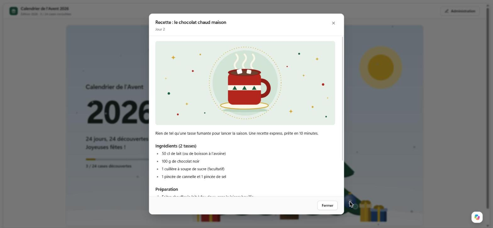

The life cycle on a site:

1. **Installation.** The package is deployed to an app catalog, then the app is added to the site. This creates four empty lists.
2. **First launch.** When a site owner opens a page with the web part, the lists are checked and repaired, their titles are translated into English and French, and the *Visits* list is secured.
3. **Demo content.** As long as the *Posts* list has no **published** post for the edition displayed, readers see the 24 demo posts built into the app.
4. **Your content.** Administrators import the demo posts to edit them, or create their own posts. As soon as one post of the edition is published, only the list content is shown.
5. **Opening the doors.** Each door opens on its date; readers click it to read the post.
6. **Visits.** Every door a reader opens is recorded in the *Visits* list, so the "Opened" badge follows them from one device to another.

**Door states** (the first three appear in the legend below the calendar, with counters):

| State | Meaning |
|---|---|
| Ready to open | The opening date has passed and the reader has not opened the door yet |
| Already opened | The reader has already opened this door (badge "Opened") |
| Not available yet | The opening date has not come yet (padlock, tooltip "Available on …") |
| Coming soon | No published post for this day (missing or draft) |

**Layouts.** The **Christmas tree** (default) adapts to the measured width of the web part: wide (1024 px and more, title on the left), tablet (560 to 1023 px, title above), phone portrait (under 560 px, compact header and a taller tree). The **door grid** shows 3D doors and the profile logo in its header.

<table>
  <tr>
    <td width="55%">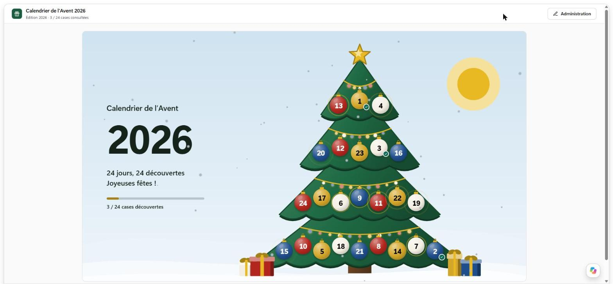</td>
    <td width="25%">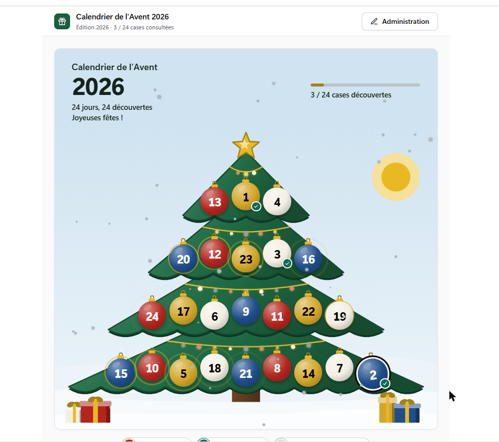</td>
    <td width="20%">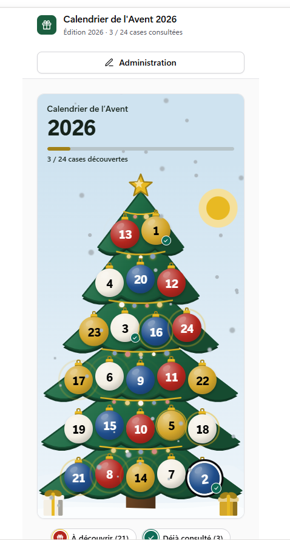</td>
  </tr>
</table>

**Full screen.** In read mode, the page hides the Microsoft 365 top bar, the app bar and the page command bar, and switches the page to focus mode, so the calendar gets the whole screen. In edit mode, the page keeps its usual chrome. Add `?chrome=1` to the page URL to disable full screen.

## 2. Installation and first launch

### Deploy the package

1. Get `sharepoint/solution/advent-calendar.sppkg` from the repository, or build it (see the [README](../README.md#clone-and-build)).
2. Upload it to the **tenant app catalog** (SharePoint admin center › More features › Apps) or to a **site collection app catalog** (*Apps for SharePoint* library), and confirm the deployment.
3. No API permission is requested: nothing to approve.

### Add the app to a site

Deployment is site by site. On each site that will host a calendar: **Site contents › New › App › Advent Calendar**. The app's feature creates four lists, **empty**:

| List (URL) | Title in English / in French | Role | Main columns |
|---|---|---|---|
| `Lists/AdventPublications` | Advent Calendar – Posts / Calendrier de l'Avent – Publications | Posts: one per day (`AdvDay`, 1–24) and per edition (`AdvYear`) | `Title`, `AdvUnlockDate`, `AdvImage`, `AdvBody` (rich text), `AdvLink`, `AdvPublished`, `AdvKey` (hidden, year-day, unique) |
| `Lists/AdventSettings` | Advent Calendar – Settings / Calendrier de l'Avent – Paramétrage | Theme profiles | `Title`, `AdvIsActive`, colors, tree settings, font, logo, title, corner radius (0 to 32 px), snow |
| `Lists/AdventAdmins` | Advent Calendar – Administrators / Calendrier de l'Avent – Administrateurs | Calendar administrators | `Title`, `AdvAdminUser` (person, users only) |
| `Lists/AdventViews` | Advent Calendar – Visits / Calendrier de l'Avent – Consultations | Doors opened, one row per user and per edition | `Title`, `AdvYear`, `AdvViewedCount`, `AdvViewedDays` (JSON), `AdvViewKey` (hidden); user = *Created By*, last view = *Modified* |

The lists are identified by their **URL**, never by their title: you can rename them.

**Titles in English and French.** The lists, their columns and their content types are created with French titles, then the web part adds the English titles as SharePoint multilingual titles (see [First launch](#first-launch)): a user whose display language is English sees *Advent Calendar – Posts*, *Day*, *Opening date*…, a French-speaking user sees *Calendrier de l'Avent – Publications*, *Jour*, *Date d'ouverture*… On a site whose default language is neither French nor English, the default titles become the English ones.

### Add the web part

Edit a page, open the toolbox and add **Advent Calendar** (category *Advanced*). It also fits a full-width section. Publish the page.

### First launch

Ask a **site owner** to open the page once. On load, the web part:

- checks that the four lists and their columns exist, and creates what is missing (lists, columns, indexes, unique keys, `#RRGGBB` validation formulas on the color columns);
- secures the *Visits* list: each user can only read and edit their own rows, attachments are disabled, read-only groups (visitors) get *Contribute* so that they can record their views, and *Edit* / *Design* levels are lowered to *Contribute*;
- sets the English and French titles of the lists, columns and content types (SharePoint multilingual titles, `fr-FR` and `en-US`). **A title you renamed is never overwritten**: a title is only translated while it still has its original French or English value.

Creating lists and columns requires the *Manage Lists* permission; securing the *Visits* list requires *Manage Permissions*; translating the titles is done for site owners only, as it also covers the site columns and content types (site owners have every permission needed). The check runs once per browser session; the translation of the titles runs once per site and per browser, and again whenever a list or a column had to be created. Messages you may see:

| Message | Meaning |
|---|---|
| "The following missing items were created automatically:" | Repair done, nothing to do |
| "Some list settings could not be applied (non-blocking):" | An index, a validation formula, a title translation or the *Visits* list security could not be applied, usually for lack of permissions. Ask a site owner to open the page |
| "The calendar lists are missing or incomplete on this site…" | A required list or column is missing and the current user cannot create it. A site owner must add the app or open the page |

**Recommended right after installation:** [secure the lists](#secure-the-lists) and [add the administrators](#add-or-remove-administrators).

## 3. Example content

### Built-in demo content

The package contains 24 demo posts, each with its own illustration: welcome and origin of the Advent calendar, recipes (hot chocolate, spiced cookies, chocolate truffles), crafts (paper snowflake, dried orange garland), riddles, a quiz and jokes with hidden answers, traditions (Saint Nicholas, Saint Lucy, Las Posadas, winter solstice, Christmas around the world), team games (Secret Santa, ugly sweater day), a public-domain carol playlist, books and films, kindness and eco challenges, and season's greetings.

The calendar displays them **as long as the *Posts* list has no published post for the edition displayed**. They follow each reader's language (French or English). Administrators see an information message above the calendar. They are examples: replace them with your own content.

**Drafts do not count.** You can prepare all your posts as drafts: readers keep seeing the demo content instead of an empty calendar. As soon as **one** post of the edition is published, the demo content disappears for everyone and only the published posts of the list are shown (the other days show "Coming soon"). Publish your posts together when they are ready: each door still opens on its own date.

While the demo content is displayed, opened doors are only remembered in the reader's browser; they are not written to the *Visits* list.

### Import the demo content to edit it

1. Click **Administration**, then the **Posts** tab.
2. When the selected edition has no post at all, a **Demo content** card appears. Click **Import the demo content** and confirm.
3. The 24 posts are created **published** in the list, in the language of the administrator who imports them, and their illustrations are copied to **Site Assets › AdventCalendarDemo** (`day-01.svg` … `day-24.svg`). Days that already have a post are left unchanged.
4. Edit, replace or delete the posts like any other post (see [Managing posts](#4-managing-posts)).

If an illustration cannot be copied, the post is created without an image and a warning tells you how many images failed (see [Troubleshooting](#11-troubleshooting)). The `AdventCalendarDemo` folder is reserved for the demo: importing again overwrites files with the same name.

### Remove the demo content

- **Before import**: publish at least one post of your own for the edition; the demo content disappears for everyone.
- **After import**: delete the posts you do not want (they go to the site recycle bin), and delete the `AdventCalendarDemo` folder from Site Assets if you no longer use its images.

### Alternative: the seed script

`scripts/seed-demo.ps1` (PnP PowerShell) creates the same content from a workstation, for example to prepare a site in advance.

Requirements: PowerShell 7.4+, the PnP.PowerShell 3.x module (`Install-Module PnP.PowerShell -Scope CurrentUser`), a Microsoft Entra ID application registered for PnP PowerShell interactive login (see the [PnP PowerShell documentation](https://pnp.github.io/powershell/)), and the app already added to the site. Run it from a clone of the repository: it reads the illustrations from `src/webparts/adventCalendar/assets/demo`.

| Parameter | Default | Effect |
|---|---|---|
| `-SiteUrl` | (required) | URL of the site |
| `-Year` | current year from September to December, previous year from January to August (as the **Year** selector of the administration screen) | Edition to fill |
| `-Language` | `fr` | `fr` or `en`: language of the posts and of the profile name |
| `-ClientId` | `ENTRAID_APP_ID` environment variable | Entra ID application used by PnP PowerShell |
| `-DraftDays` | none | Days created as drafts, for example `23,24` |
| `-Overwrite` | off | Replaces the posts of the days that already have one |
| `-ActivateProfile` | off | Makes the *Classic* profile the active one and deactivates the others |
| `-WhatIf` / `-Confirm` | off | Shows what would be written without writing anything / asks before each change |

```powershell
# Preview first, then run
./scripts/seed-demo.ps1 -SiteUrl https://contoso.sharepoint.com/sites/xmas -ClientId 00000000-0000-0000-0000-000000000000 -Language en -Year 2026 -WhatIf
./scripts/seed-demo.ps1 -SiteUrl https://contoso.sharepoint.com/sites/xmas -ClientId 00000000-0000-0000-0000-000000000000 -Language en -Year 2026
```

The script is **safe by default**, like the import from the administration screen:

- it **creates** the demo post of every day of the edition that has no post yet, with an explicit opening date (December *N* at midnight). Days that already have a post, published or draft, are **left unchanged**; with `-Overwrite`, they are replaced by the demo post;
- it uploads the illustrations of the days it writes to *Site Assets › AdventCalendarDemo* (files with the same name are overwritten: the folder is reserved for the demo content);
- it creates a *Classic* (or *Classique*) profile with the header title "Our Advent calendar *year*", **active only if no profile is active yet**. Existing profiles, including one that already has this name, are never modified. With `-ActivateProfile`, the *Classic* profile becomes the active one (its values are kept if it already exists) and the other profiles are deactivated.

Full help: `Get-Help ./scripts/seed-demo.ps1 -Full`.

## 4. Managing posts

Open **Administration › Posts**.

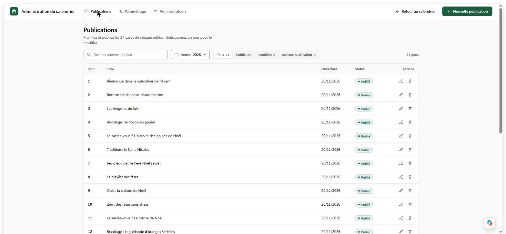

- **Filters**: search by title or day number, **Year** selector, status (*All*, *Published*, *Draft*, *No post*) with counters. The **Year** selector opens on the edition displayed by the web part, except from September to October, when it opens on the upcoming edition (current year) so that you can prepare it while readers still see the previous one. It offers that year, the previous one and the next two. When *Edition (year)* is set in the web part properties, it opens on that year.
- **Table**: one row per day: *Day*, *Title*, *Opens on*, *Status*, *Actions* (edit, delete). Click a row to edit it, or create the post of an empty day.
- **New post** (top bar) opens the form on the first free day of the selected edition.
- **Delete** moves the post to the site recycle bin.

### The post form

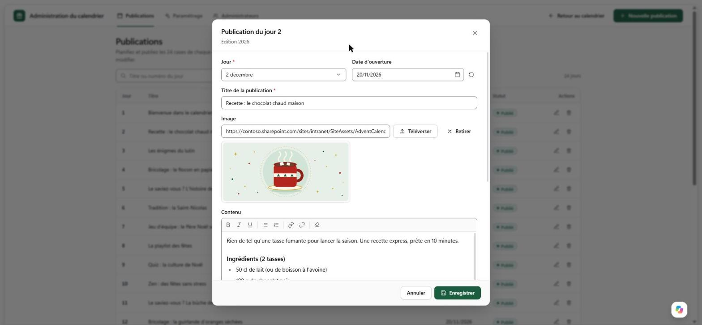

| Field | Details |
|---|---|
| **Day** | December 1 to 24. Days already used are marked "(already used)": a day can only have one post per edition |
| **Opening date** | Optional. Empty = December *N* of the edition at 00:00, in each reader's local time. Set a date to open the door earlier or later; the reset button returns to the default date |
| **Post title** | Required |
| **Image** | An `https://` URL, or **Upload** to copy a file to *Site Assets › AdventCalendar* (images only, 5 MB maximum). **Remove** clears it. Without an image, the pop-up shows a banner with the day number in the profile colors |
| **Content** | Rich text editor: bold, italic, underline, bulleted and numbered lists, insert / remove a link, clear formatting. Headings and collapsible blocks already present (as in the demo content) are kept |
| **"Learn more" link (URL)** and **Link text** | Optional button at the bottom of the pop-up; the default text is "Learn more" |
| **Status** | *Draft* (default for a new post) or *Published*. Readers only see published posts; a draft day shows "Coming soon" |

Content is sanitized when saved and when displayed: scripts, forms, iframes (embedded videos included) and the `style`, `class` and `id` attributes are removed; links always open in a new tab. Use a link to share a video.

> **Locking is visual, not an embargo.** Published and draft posts, including future ones, can be read by anyone with read access to the site through the SharePoint REST API. Never store confidential content in the calendar before its date.

## 5. Administration and permissions

### Who can open the administration screen

The **Administration** button is shown to:

- **site owners** (site collection administrators, or users with the *Manage Web* permission, typically the *Owners* group), who are always administrators;
- **listed administrators**: users added in **Administration › Administrators** (list `AdventAdmins`, users only, no groups).

Everyone else only sees the calendar.

### Add or remove administrators

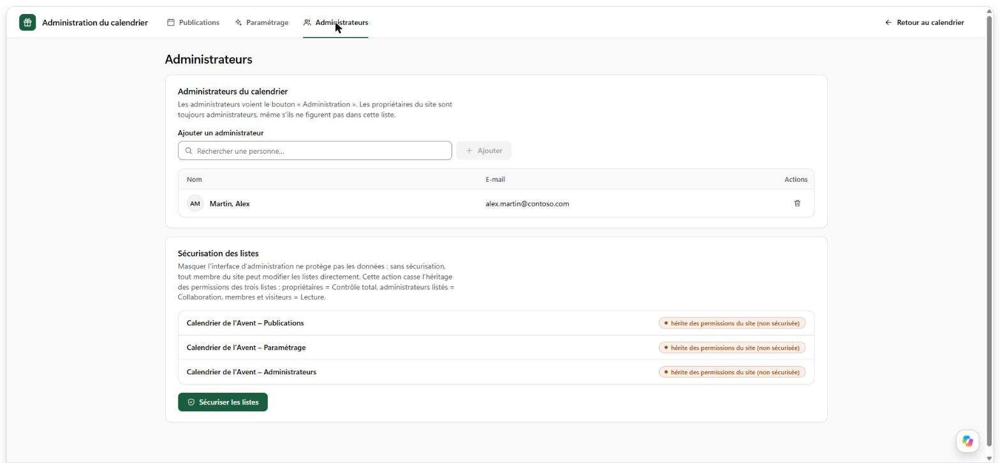

1. In **Add an administrator**, type at least 2 characters, pick a person, then **Add**.
2. To remove someone, use the bin icon in the *Actions* column and confirm.

### Secure the lists

Hiding the administration screen does **not** protect the data: as long as the lists inherit the site permissions, any site member can edit posts, profiles and administrators directly in SharePoint or through the API.

The **List security** card shows the status of the three content lists (*unique permissions (secured)* or *inherits the site permissions (not secured)*). **Secure the lists** (site owners only) breaks permission inheritance on `AdventPublications`, `AdventSettings` and `AdventAdmins`, and applies:

| Who | Permission level |
|---|---|
| Site owners group | Full Control |
| Listed administrators | Contribute |
| Site members and visitors groups | Read |
| Any other group with access | Read |
| Other users with direct permissions | Removed |

The person who applies the security keeps their direct access. The *Visits* list is never affected by this button (it has its own item-level security, see [section 8](#8-visit-tracking-and-privacy)). To undo, restore inheritance from each list's settings.

**Re-synchronization.** When the lists are secured and a **site owner** adds or removes an administrator, the permissions are updated automatically ("The list permissions have been updated."). When a listed administrator who is not a site owner does it, the lists keep their previous permissions and a message asks a site owner to click **Reapply permissions**.

**Best practices**

- Secure the lists right after installation, then add the administrators.
- Use administrators for content editors and keep the *Owners* group small.
- Click **Reapply permissions** after changing site groups or if someone was given direct permissions on the lists.

## 6. Theme profiles

A theme profile customizes **the calendar only** (tree or grid, pop-up colors, logo). The administration screen and the top bar keep their neutral style. Profiles are stored in the `AdventSettings` list.

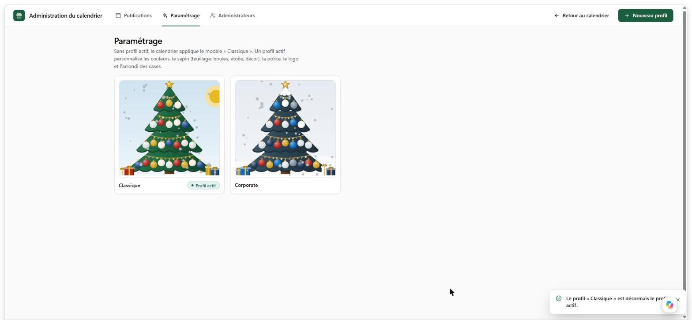

### Create a profile from a template

1. **Administration › Settings › New profile**.
2. Choose one of the 6 templates:

   | Template | Style |
   |---|---|
   | Classic | Fir green, berry red and gold under a winter sky (default theme) |
   | Nordic | White, glacier blue and silver in a snowy landscape |
   | Starry night | Midnight blue, moon and stars, golden baubles |
   | Frosted pastel | Powder pink, mint and lavender |
   | Corporate | Neutral and understated, no snow: ready to recolor in your organization's colors |
   | Chalet | Burgundy, wood and cream, evening scenery |

   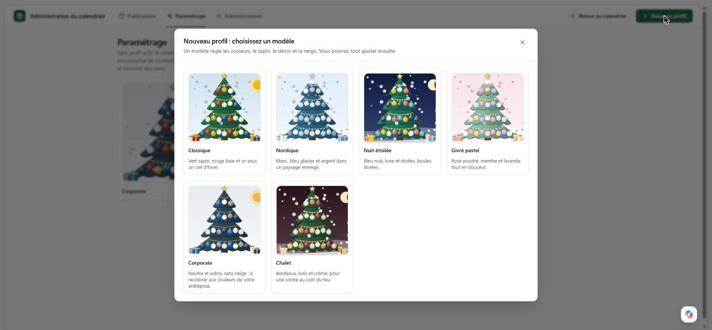

3. Adjust the profile (live **Preview** on the right), then **Save**.
4. Click **Set as active**. Only one profile is active at a time. Without an active profile, the *Classic* template applies.

**Apply a template** (in the *Tree* section of an existing profile) replaces the colors and tree settings, and keeps the name, title, logo and font.

### What you can customize

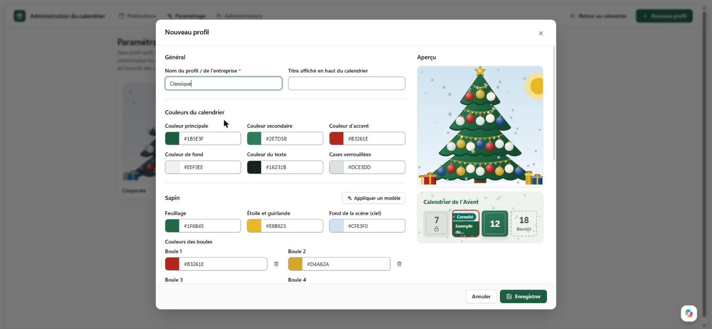

| Section | Settings |
|---|---|
| **General** | *Profile / organization name*; *Title displayed at the top of the calendar* (top bar; default "Advent Calendar *year*") |
| **Calendar colors** | Primary, secondary, accent, background, text, locked doors (`#RRGGBB`, color picker). Text placed on these colors is recalculated automatically for contrast |
| **Tree** | Foliage; Star and garland; Scene background (sky); Bauble colors (3 to 6, used in turn on the 24 baubles); Scenery (*Day*, *Snow*, *Night*); String lights (twinkling lights) |
| **Typography and shape** | *Font (CSS font-family)*; *Door corner radius* (0 to 32 px); *Font file URL (optional)* |
| **Logo and animation** | *Logo* (URL, or **Upload** to *Site Assets › AdventCalendar*); *Snow animation* |

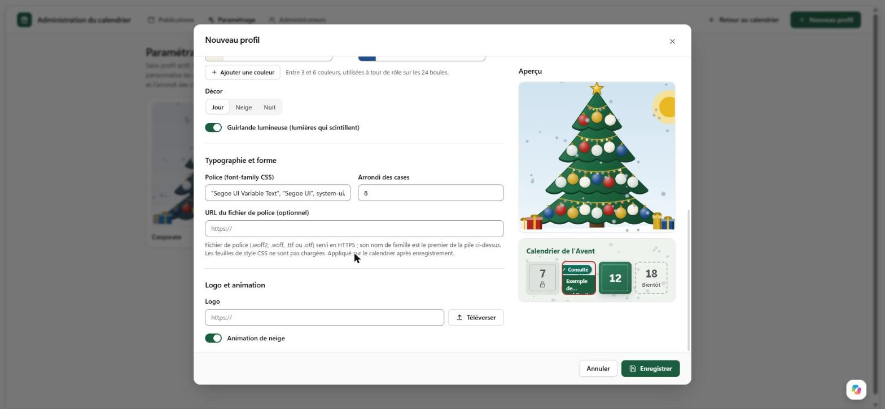

**Font.** Leave the system font stack, or enter a font already available on users' devices. To load a web font, enter the HTTPS URL of a font **file** (`.woff2`, `.woff`, `.ttf` or `.otf`) and put its family name **first** in the *Font* field. CSS stylesheets (such as web font service URLs) are refused for security reasons. The font is applied to the calendar once the profile is saved.

**Logo.** Displayed in the tree's title block and in the grid header. Use an image your readers can access (for example in Site Assets).

### Force a profile on one web part

The **Theme profile** web part property overrides the active profile for that web part only (see [section 7](#7-web-part-properties)). If the forced profile is deleted, the active profile applies again.

Deleting a profile moves it to the site recycle bin.

## 7. Web part properties

Edit the page, select the web part and open its properties.

| Group | Property | Values | Effect |
|---|---|---|---|
| Display | **Layout** | *Christmas tree* (default), *Door grid* | Presentation of the 24 doors |
| Display | **Edition (year)** | Empty, or 2000 to 2100 | Only the posts of this year are displayed. Empty = automatic edition: the current year in November and December, the previous year from January to October (see [Next year](#10-next-year)) |
| Display | **Theme profile** | *Active profile (default)* or a profile name | Forces a profile for this web part |
| Test mode | **Test mode: simulate today's date** | Yes / No | Enables the simulated date |
| Test mode | **Simulated date** | `YYYY-MM-DD` | Date used instead of today |

**Test mode** only applies while the **page is in edit mode**, with a banner "Test mode is on…". Readers always see the real date. To preview every door, use `YYYY-12-24`. When *Edition (year)* is empty, the automatic edition is computed from the simulated date (same rule: a date in November or December shows that year, a date from January to October shows the previous year).

## 8. Visit tracking and privacy

When a reader opens a door, the app records it in the `AdventViews` list: **one row per user and per edition**, with the days opened and the date of their first opening (JSON in `AdvViewedDays`), the number of days opened (`AdvViewedCount`), the user (*Created By*) and the last view (*Modified*). The "Opened" badges and the legend counters come from this list, so they follow the reader across devices.

- If the list cannot be read, the calendar falls back to the doors remembered in the browser and shows a warning with a **Retry** button.
- If a view cannot be saved, the door is not marked "Opened" and a warning is shown.
- Doors of the built-in demo content are not recorded in the list.

**Item-level security.** Each user can only read and edit their own rows (list setting *Read / Create and edit items that were created by the user*). Attachments are disabled.

**Privacy (GDPR).** The list is personal data: who opened which door, and when. Site owners (Full Control) and site collection administrators can read every row. Inform your users according to your data protection policy, decide on a retention period, and delete the rows of past editions when you no longer need them.

## 9. Languages

The interface, date formats and demo content are in **English** or **French**:

- users whose SharePoint display language is **`fr-FR`** get French;
- **every other language** gets English, including `fr-CA` and `fr-BE`. To support them, a developer can add a strings file such as `loc/fr-ca.js` (a copy of `fr-fr.js` with `UiLocale` set accordingly).

The SharePoint display language is the user's preferred language, **if the site offers it**:

- **User**: set the preferred language in the Microsoft 365 account settings (or the SharePoint profile, *Language and Region*). It may take some time to apply.
- **Site**: a site owner enables it in **Site settings › Language settings** (site default language or an alternate language).

**List titles and column names** follow the same display language, through SharePoint multilingual titles: English for `en-US`, French for `fr-FR` (see [Add the app to a site](#add-the-app-to-a-site)). They are set the first time a site owner opens the page, and a title renamed by an administrator is kept as is. Like the interface, they only change language if the site offers the user's language.

Demo content imported into the list keeps the language of the administrator who imported it.

## 10. Next year

- **Edition (year) empty** (default): the calendar shows the **current year in November and December**, and the **previous year from January to October**. After Christmas, the calendar that has just ended therefore stays available until the end of October, with every door open; on **November 1**, it switches to the new edition, whose doors open from December 1. If the new edition has no published post yet, readers see the demo content (doors locked until their date).
- **Fixed year**: set *Edition (year)* to keep a given edition on the page all year round. It applies to readers and to the default year of the administration screen.
- **Prepare the next edition in advance**: from **September**, **Administration › Posts** opens directly on the upcoming edition (current year); earlier in the year, select it in the **Year** selector. Create the posts as drafts and publish them before December 1 (drafts do not replace the demo content, see [Built-in demo content](#built-in-demo-content)), or import the demo content for that year (posts created published). Posts of each edition are kept in the same list (`AdvYear`).
- **Reuse previous content**: there is no copy function. Create the new posts in the administration screen (copy and paste from last year's posts) or import the demo content again. Do not change `AdvYear` directly in the list: the hidden `AdvKey` key (year-day) would no longer match.
- **Visits** are tracked per edition: each reader starts again with no door opened.

## 11. Troubleshooting

| Symptom | Cause and solution |
|---|---|
| "The calendar lists are missing or incomplete on this site…" | The app is not added to the site, or a list or required column was deleted. Add the app (*Site contents › New › App*), or ask a site owner to open the page: missing items are created automatically |
| "Some list settings could not be applied (non-blocking):" | The user lacked *Manage Lists* or *Manage Permissions* (for example a member with *Edit* level), or SharePoint refused a title translation. A site owner opens the page in a new browser session (the check runs once per session) |
| No **Administration** button | The user is neither a site owner nor a listed administrator, or the lists are missing |
| "Only site owners can secure the lists." | Securing the lists requires a site owner |
| "The lists are secured: a site owner must click "Reapply permissions"…" | A non-owner administrator changed the administrators; a site owner clicks **Reapply permissions** |
| "{n} illustrations could not be copied to Site Assets…" after the demo import | The illustrations are downloaded from the app files before being copied. When the Office 365 public or private CDN serves them without cross-origin headers, or the user cannot write to Site Assets, the posts are created without images. Upload the SVG files from `src/webparts/adventCalendar/assets/demo` to *Site Assets › AdventCalendarDemo* and set each post's image, or check the CDN configuration |
| The profile font is not applied | The URL must be HTTPS and end with `.woff2`, `.woff`, `.ttf` or `.otf`; the server must allow cross-origin requests; the family name must be the first one in *Font*; save the profile |
| Saving a profile fails on a site upgraded from an older version | New columns have not been created yet: a site owner opens the page first |
| All doors are locked | The opening dates have not come yet. Check the *Edition (year)* property, or use test mode (page in edit mode) to preview |
| Test mode has no effect | It only applies in edit mode, with a valid `YYYY-MM-DD` date |
| The "Opened" badge does not appear | Demo content is not recorded in the list; otherwise read the warning shown above the calendar |
| The SharePoint top bar is hidden | Read-mode full screen. Add `?chrome=1` to the page URL, or edit the page |
| The wrong theme is displayed | The *Theme profile* property forces a profile on this web part; set it back to *Active profile (default)* |
| The interface is in English for a French-speaking user | Their display language is not `fr-FR` (see [Languages](#9-languages)) |
| List or column titles are in French for an English-speaking user | The titles are translated the first time a site owner opens the page; the site must offer the user's language (*Site settings › Language settings*); a title renamed by an administrator is never translated. Any failure is listed in the "Some list settings could not be applied" message |

## 12. FAQ

**Can I have several calendars on the same site?**
All web parts of a site share the same four lists. You can show different editions (*Edition (year)*) or looks (*Theme profile*), but separate content needs separate sites.

**Can I hide the content of a door until its date?**
No. Locking is visual: posts can be read through the REST API. Keep sensitive content out of the calendar.

**Can I embed a video?**
No, iframes are removed for security. Add a link to the video (*"Learn more" link* or a link in the text).

**Who can see who opened which door?**
Each user only sees their own rows. Site owners and site collection administrators can read the whole *Visits* list.

**Does the app need API permissions or custom scripts?**
No. The package requests no API permission and does not require custom scripts on the site.

**How do I update the app?**
Upload the new `.sppkg` to the app catalog to replace the previous version. If *Site contents* offers an update for the app, apply it. Schema changes are applied by the web part itself the first time a site owner opens the page.

**How do I remove the app?**
Remove it from *Site contents*. The four lists and the Site Assets folders may remain: delete them manually if you no longer need them.

**Is the app accessible?**
Doors and baubles are buttons with descriptive labels, keyboard focus is always visible, dialogs keep the focus inside them, information is never conveyed by color alone, and animations stop when the device asks for reduced motion.

---

## Author

Designed and developed by **MARZAQ Ahmed**, SharePoint, Microsoft 365 and SharePoint Framework (SPFx) consultant.

- Website: [marzaqconsulting.fr](https://marzaqconsulting.fr/)
- LinkedIn: [Ahmed MARZAQ](https://www.linkedin.com/in/ahmed-marzaq-519221155/)

Released under the [MIT License](../LICENSE).
