# Calendrier de l'Avent : guide d'administration

Ce guide explique comment installer, paramétrer et faire vivre le web part « Calendrier de l'Avent » sur un site SharePoint Online. Pour une présentation rapide et la compilation du projet, consultez le [README](../README.md) (en anglais). 🇬🇧 [English version](GUIDE.en.md).

## Sommaire

1. [Présentation et fonctionnement](#1-présentation-et-fonctionnement)
2. [Installation et premier lancement](#2-installation-et-premier-lancement)
3. [Contenu d'exemple](#3-contenu-dexemple)
4. [Gérer les publications](#4-gérer-les-publications)
5. [Administration et droits](#5-administration-et-droits)
6. [Profils de thème](#6-profils-de-thème)
7. [Propriétés du web part](#7-propriétés-du-web-part)
8. [Suivi des consultations et vie privée](#8-suivi-des-consultations-et-vie-privée)
9. [Langues](#9-langues)
10. [L'année suivante](#10-lannée-suivante)
11. [Dépannage](#11-dépannage)
12. [FAQ](#12-faq)

[Auteur](#auteur)

---

## 1. Présentation et fonctionnement

Le calendrier affiche 24 cases, une par jour du 1er au 24 décembre. Chaque case reste verrouillée jusqu'à sa date d'ouverture ; elle ouvre ensuite une pop-up avec la publication du jour : titre, image, texte mis en forme et, si besoin, un lien « En savoir plus ».

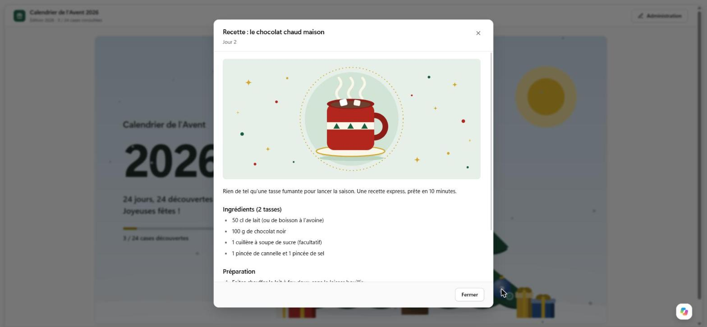

Le cycle de vie sur un site :

1. **Installation.** Le package est déployé dans un catalogue d'applications, puis l'application est ajoutée au site, ce qui crée quatre listes vides.
2. **Premier lancement.** Quand un propriétaire du site affiche une page qui contient le web part, les listes sont vérifiées et réparées, leurs titres sont traduits en français et en anglais, et la liste des consultations est sécurisée.
3. **Contenu de démonstration.** Tant que la liste des publications ne contient aucune publication **publiée** pour l'édition affichée, les lecteurs voient les 24 publications de démonstration intégrées à l'application.
4. **Votre contenu.** Les administrateurs importent les publications de démonstration pour les modifier, ou créent les leurs. Dès qu'une publication de l'édition est publiée, seul le contenu de la liste est affiché.
5. **Ouverture des cases.** Chaque case s'ouvre à sa date ; le lecteur clique dessus pour lire la publication.
6. **Consultations.** Chaque case ouverte est enregistrée dans la liste des consultations : le badge « Consulté » suit le lecteur d'un appareil à l'autre.

**États des cases** (les trois premiers figurent dans la légende sous le calendrier, avec des compteurs) :

| État | Signification |
|---|---|
| À découvrir | La date d'ouverture est passée et le lecteur n'a pas encore ouvert la case |
| Déjà consulté | Le lecteur a déjà ouvert cette case (badge « Consulté ») |
| Pas encore disponible | La date d'ouverture n'est pas atteinte (cadenas, infobulle « Disponible le … ») |
| Bientôt | Aucune publication publiée pour ce jour (absente ou en brouillon) |

**Présentations.** Le **sapin** (par défaut) s'adapte à la largeur réelle du web part : large (1 024 px et plus, titre à gauche), tablette (de 560 à 1 023 px, titre au-dessus), téléphone en portrait (moins de 560 px, en-tête compact et sapin plus haut). La **grille de portes** affiche des portes en 3D et le logo du profil dans son en-tête.

<table>
  <tr>
    <td width="55%">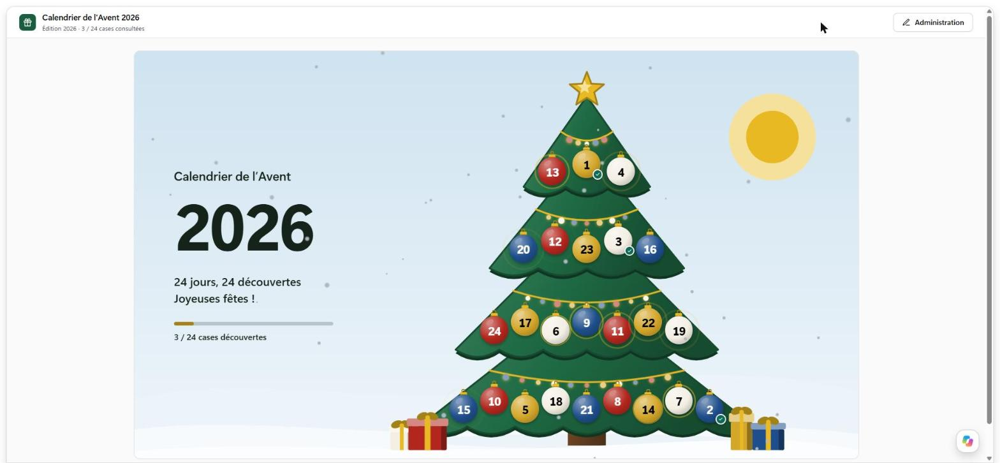</td>
    <td width="25%">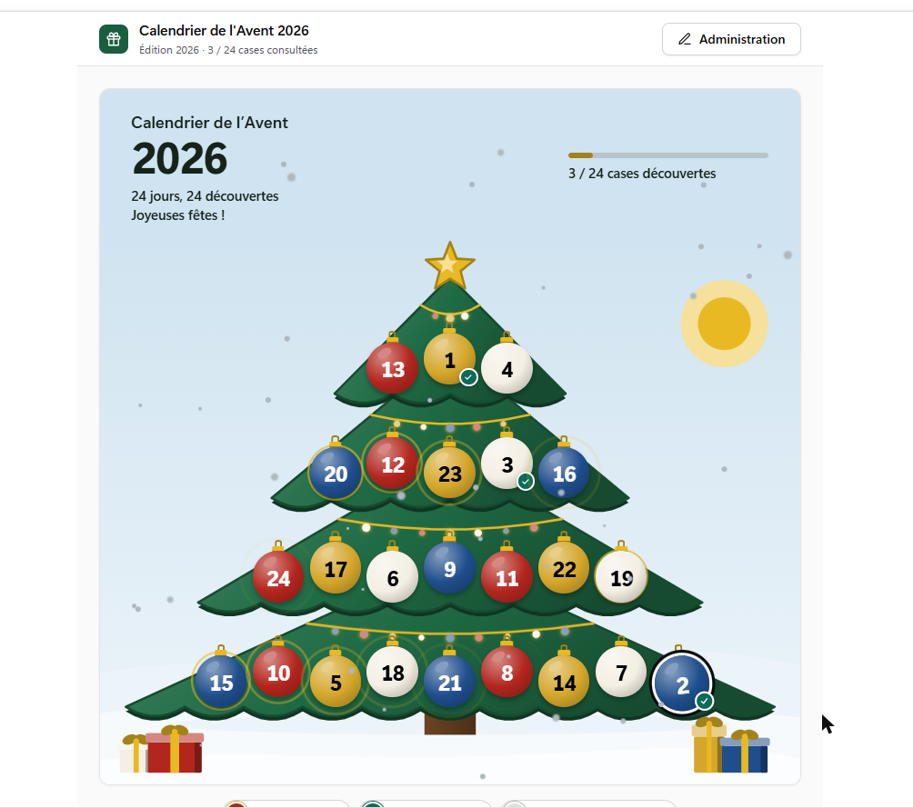</td>
    <td width="20%">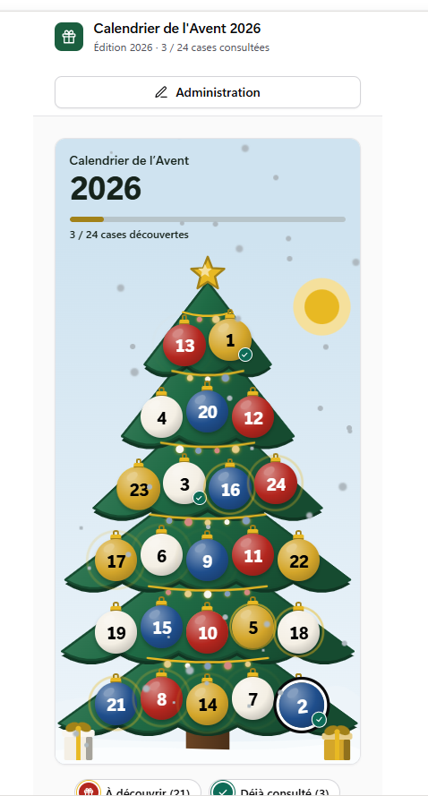</td>
  </tr>
</table>

**Plein écran.** En mode lecture, la page masque la barre Microsoft 365, la barre d'applications et la barre de commandes de la page, et passe en mode focus : le calendrier occupe tout l'écran. En mode édition, la page garde son affichage habituel. Ajoutez `?chrome=1` à l'adresse de la page pour désactiver le plein écran.

## 2. Installation et premier lancement

### Déployer le package

1. Récupérez `sharepoint/solution/advent-calendar.sppkg` dans le dépôt, ou compilez-le (voir le [README](../README.md#clone-and-build)).
2. Déposez-le dans le **catalogue d'applications du tenant** (Centre d'administration SharePoint › Autres fonctionnalités › Applications) ou dans un **catalogue d'applications de collection de sites** (bibliothèque *Applications pour SharePoint*), puis confirmez le déploiement.
3. Aucune permission d'API n'est demandée : rien à approuver.

### Ajouter l'application au site

Le déploiement se fait site par site. Sur chaque site qui accueillera un calendrier : **Contenu du site › Nouveau › Application › Advent Calendar**. La fonctionnalité de l'application crée quatre listes, **vides** :

| Liste (URL) | Titre en français / en anglais | Rôle | Colonnes principales |
|---|---|---|---|
| `Lists/AdventPublications` | Calendrier de l'Avent – Publications / Advent Calendar – Posts | Publications : une par jour (`AdvDay`, 1 à 24) et par édition (`AdvYear`) | `Title`, `AdvUnlockDate`, `AdvImage`, `AdvBody` (texte enrichi), `AdvLink`, `AdvPublished`, `AdvKey` (masquée, année-jour, unique) |
| `Lists/AdventSettings` | Calendrier de l'Avent – Paramétrage / Advent Calendar – Settings | Profils de thème | `Title`, `AdvIsActive`, couleurs, réglages du sapin, police, logo, titre, arrondi (de 0 à 32 px), neige |
| `Lists/AdventAdmins` | Calendrier de l'Avent – Administrateurs / Advent Calendar – Administrators | Administrateurs du calendrier | `Title`, `AdvAdminUser` (personne, utilisateurs uniquement) |
| `Lists/AdventViews` | Calendrier de l'Avent – Consultations / Advent Calendar – Visits | Cases ouvertes, une ligne par utilisateur et par édition | `Title`, `AdvYear`, `AdvViewedCount`, `AdvViewedDays` (JSON), `AdvViewKey` (masquée) ; utilisateur = *Créé par*, dernière consultation = *Modifié* |

Les listes sont identifiées par leur **URL**, jamais par leur titre : vous pouvez les renommer.

**Titres en français et en anglais.** Les listes, leurs colonnes et leurs types de contenu sont créés avec des titres français, puis le web part ajoute les titres anglais sous forme de titres multilingues SharePoint (voir [Premier lancement](#premier-lancement)) : un utilisateur dont la langue d'affichage est l'anglais voit *Advent Calendar – Posts*, *Day*, *Opening date*…, un utilisateur francophone voit *Calendrier de l'Avent – Publications*, *Jour*, *Date d'ouverture*… Sur un site dont la langue par défaut n'est ni le français ni l'anglais, les titres par défaut deviennent les titres anglais.

### Ajouter le web part

Modifiez une page, ouvrez la boîte à outils et ajoutez **Calendrier de l'Avent** (catégorie *Avancé*). Il fonctionne aussi dans une section pleine largeur. Publiez la page.

### Premier lancement

Demandez à un **propriétaire du site** d'afficher la page une première fois. Au chargement, le web part :

- vérifie que les quatre listes et leurs colonnes existent, et crée ce qui manque (listes, colonnes, index, clés uniques, formules de validation `#RRGGBB` des colonnes de couleur) ;
- sécurise la liste des consultations : chacun ne lit et ne modifie que ses propres lignes, les pièces jointes sont désactivées, les groupes en lecture seule (visiteurs) reçoivent *Collaboration* pour pouvoir enregistrer leurs consultations, et les niveaux *Modification* / *Création* sont ramenés à *Collaboration* ;
- pose les titres français et anglais des listes, des colonnes et des types de contenu (titres multilingues SharePoint, `fr-FR` et `en-US`). **Un titre que vous avez renommé n'est jamais écrasé** : un titre n'est traduit que tant qu'il a encore sa valeur d'origine, française ou anglaise.

Créer des listes et des colonnes demande le droit *Gérer les listes* ; sécuriser la liste des consultations demande *Gérer les autorisations* ; la traduction des titres est réservée aux propriétaires du site, car elle porte aussi sur les colonnes et les types de contenu du site (les propriétaires ont tous les droits nécessaires). La vérification a lieu une fois par session de navigateur ; la traduction des titres, une fois par site et par navigateur, puis de nouveau chaque fois qu'une liste ou une colonne a dû être créée. Messages possibles :

| Message | Signification |
|---|---|
| « Les éléments manquants suivants ont été créés automatiquement : » | Réparation effectuée, rien à faire |
| « Certains réglages des listes n'ont pas pu être appliqués (non bloquant) : » | Un index, une formule de validation, une traduction de titre ou la sécurité de la liste des consultations n'a pas pu être posé, en général faute de droits. Demandez à un propriétaire d'afficher la page |
| « Les listes du calendrier sont absentes ou incomplètes sur ce site… » | Une liste ou une colonne obligatoire manque et l'utilisateur ne peut pas la créer. Un propriétaire doit ajouter l'application ou afficher la page |

**Juste après l'installation, nous recommandons de** [sécuriser les listes](#sécuriser-les-listes) puis d'[ajouter les administrateurs](#ajouter-ou-retirer-des-administrateurs).

## 3. Contenu d'exemple

### Contenu de démonstration intégré

Le package contient 24 publications de démonstration, chacune avec sa propre illustration : accueil et origine du calendrier de l'Avent, recettes (chocolat chaud, biscuits épicés, truffes au chocolat), bricolages (flocon en papier, guirlande d'oranges séchées), énigmes, quiz et blagues à réponses cachées, traditions (Saint-Nicolas, Sainte-Lucie, Las Posadas, solstice d'hiver, Noël autour du monde), jeux d'équipe (Père Noël secret, journée du pull moche), playlist d'airs du domaine public, livres et films, défis solidarité et écologie, et vœux de fin d'année.

Le calendrier les affiche **tant que la liste des publications ne contient aucune publication publiée pour l'édition affichée**. Elles suivent la langue de chaque lecteur (français ou anglais). Les administrateurs voient un message d'information au-dessus du calendrier. Ce ne sont que des exemples : remplacez-les par votre propre contenu.

**Les brouillons ne comptent pas.** Vous pouvez préparer toutes vos publications en brouillon : les lecteurs continuent de voir le contenu de démonstration plutôt qu'un calendrier vide. Dès qu'**une** publication de l'édition est publiée, le contenu de démonstration disparaît pour tout le monde et seules les publications publiées de la liste sont affichées (les autres jours affichent « Bientôt »). Publiez donc vos publications ensemble quand elles sont prêtes : chaque case s'ouvre toujours à sa propre date.

Tant que le contenu de démonstration est affiché, les cases ouvertes ne sont mémorisées que dans le navigateur du lecteur ; elles ne sont pas enregistrées dans la liste des consultations.

### Importer le contenu de démonstration pour le modifier

1. Cliquez sur **Administration**, puis sur l'onglet **Publications**.
2. Quand l'édition sélectionnée ne contient aucune publication, un encart **Contenu de démonstration** apparaît. Cliquez sur **Importer le contenu de démonstration** et confirmez.
3. Les 24 publications sont créées **publiées** dans la liste, dans la langue de l'administrateur qui importe, et leurs illustrations sont copiées dans **Ressources du site › AdventCalendarDemo** (`day-01.svg` … `day-24.svg`). Les jours qui ont déjà une publication ne sont pas modifiés.
4. Modifiez, remplacez ou supprimez ces publications comme les autres (voir [Gérer les publications](#4-gérer-les-publications)).

Si une illustration ne peut pas être copiée, la publication est créée sans image et un avertissement indique le nombre d'images manquantes (voir [Dépannage](#11-dépannage)). Le dossier `AdventCalendarDemo` est réservé à la démonstration : un nouvel import écrase les fichiers de même nom.

### Retirer le contenu de démonstration

- **Sans import** : publiez au moins une publication de votre cru pour l'édition ; le contenu de démonstration disparaît pour tout le monde.
- **Après import** : supprimez les publications inutiles (elles vont dans la corbeille du site), puis le dossier `AdventCalendarDemo` des Ressources du site si ses images ne servent plus.

### Autre solution : le script de remplissage

`scripts/seed-demo.ps1` (PnP PowerShell) crée le même contenu depuis un poste de travail, par exemple pour préparer un site à l'avance.

Prérequis : PowerShell 7.4 ou plus, le module PnP.PowerShell 3.x (`Install-Module PnP.PowerShell -Scope CurrentUser`), une application Microsoft Entra ID inscrite pour la connexion interactive de PnP PowerShell (voir la [documentation PnP PowerShell](https://pnp.github.io/powershell/)) et l'application déjà ajoutée au site. Lancez-le depuis une copie du dépôt : il lit les illustrations dans `src/webparts/adventCalendar/assets/demo`.

| Paramètre | Par défaut | Effet |
|---|---|---|
| `-SiteUrl` | (obligatoire) | URL du site |
| `-Year` | année en cours de septembre à décembre, année précédente de janvier à août (comme le sélecteur **Année** de l'administration) | Édition à remplir |
| `-Language` | `fr` | `fr` ou `en` : langue des publications et du nom du profil |
| `-ClientId` | variable d'environnement `ENTRAID_APP_ID` | Application Entra ID utilisée par PnP PowerShell |
| `-DraftDays` | aucun | Jours créés en brouillon, par exemple `23,24` |
| `-Overwrite` | désactivé | Remplace les publications des jours qui en ont déjà une |
| `-ActivateProfile` | désactivé | Fait du profil *Classique* le profil actif et désactive les autres |
| `-WhatIf` / `-Confirm` | désactivés | Affiche ce qui serait écrit sans rien écrire / demande confirmation avant chaque modification |

```powershell
# Simulation d'abord, puis exécution
./scripts/seed-demo.ps1 -SiteUrl https://contoso.sharepoint.com/sites/noel -ClientId 00000000-0000-0000-0000-000000000000 -Language fr -Year 2026 -WhatIf
./scripts/seed-demo.ps1 -SiteUrl https://contoso.sharepoint.com/sites/noel -ClientId 00000000-0000-0000-0000-000000000000 -Language fr -Year 2026
```

Le script est **sans risque par défaut**, comme l'import depuis l'administration :

- il **crée** la publication de démonstration de chaque jour de l'édition qui n'en a pas encore, avec une date d'ouverture explicite (le *N* décembre à minuit). Les jours qui ont déjà une publication, publiée ou en brouillon, **ne sont pas modifiés** ; avec `-Overwrite`, ils sont remplacés par la publication de démonstration ;
- il téléverse les illustrations des jours qu'il écrit dans *Ressources du site › AdventCalendarDemo* (les fichiers de même nom sont écrasés : le dossier est réservé à la démonstration) ;
- il crée un profil *Classique* (ou *Classic*) dont le titre affiché est « Notre calendrier de l'Avent *année* », **actif seulement si aucun profil n'est encore actif**. Les profils existants, y compris un profil qui porte déjà ce nom, ne sont jamais modifiés. Avec `-ActivateProfile`, le profil *Classique* devient le profil actif (ses valeurs sont conservées s'il existe déjà) et les autres profils sont désactivés.

Aide complète : `Get-Help ./scripts/seed-demo.ps1 -Full`.

## 4. Gérer les publications

Ouvrez **Administration › Publications**.

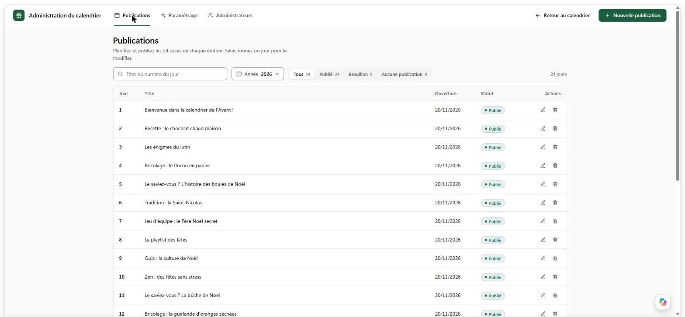

- **Filtres** : recherche par titre ou numéro du jour, sélecteur **Année**, statut (*Tous*, *Publié*, *Brouillon*, *Aucune publication*) avec compteurs. Le sélecteur **Année** s'ouvre sur l'édition affichée par le web part, sauf en septembre et en octobre, où il s'ouvre sur l'édition à venir (année en cours) pour que vous puissiez la préparer pendant que les lecteurs voient encore la précédente. Il propose cette année, la précédente et les deux suivantes. Quand *Édition (année)* est renseignée dans les propriétés du web part, il s'ouvre sur cette année.
- **Tableau** : une ligne par jour : *Jour*, *Titre*, *Ouverture*, *Statut*, *Actions* (modifier, supprimer). Cliquez sur une ligne pour la modifier, ou pour créer la publication d'un jour vide.
- **Nouvelle publication** (barre du haut) ouvre le formulaire sur le premier jour libre de l'édition sélectionnée.
- **Supprimer** place la publication dans la corbeille du site.

### Le formulaire de publication

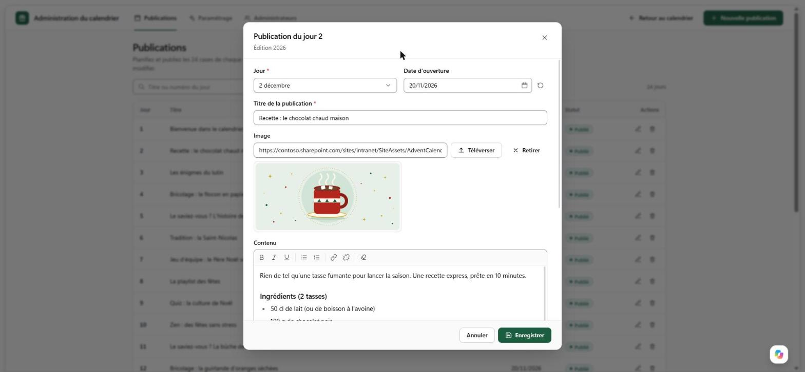

| Champ | Détails |
|---|---|
| **Jour** | Du 1er au 24 décembre. Les jours déjà pris sont signalés « (déjà utilisé) » : un jour n'a qu'une publication par édition |
| **Date d'ouverture** | Facultative. Vide = le *N* décembre de l'édition à 00:00, à l'heure locale de chaque lecteur. Indiquez une date pour ouvrir la case plus tôt ou plus tard ; le bouton de réinitialisation revient à la date par défaut |
| **Titre de la publication** | Obligatoire |
| **Image** | Une URL `https://`, ou **Téléverser** pour copier un fichier dans *Ressources du site › AdventCalendar* (images uniquement, 5 Mo au maximum). **Retirer** l'efface. Sans image, la pop-up affiche un bandeau avec le numéro du jour aux couleurs du profil |
| **Contenu** | Éditeur de texte enrichi : gras, italique, souligné, listes à puces et numérotées, insertion et suppression de lien, effacement de la mise en forme. Les titres et blocs dépliables déjà présents (comme dans le contenu de démonstration) sont conservés |
| **Lien « En savoir plus » (URL)** et **Texte du lien** | Bouton facultatif en bas de la pop-up ; texte par défaut : « En savoir plus » |
| **Statut** | *Brouillon* (par défaut pour une nouvelle publication) ou *Publié*. Les lecteurs ne voient que les publications publiées ; un jour en brouillon affiche « Bientôt » |

Le contenu est assaini à l'enregistrement et à l'affichage : scripts, formulaires, iframes (vidéos intégrées comprises) et attributs `style`, `class` et `id` sont retirés ; les liens s'ouvrent toujours dans un nouvel onglet. Pour partager une vidéo, utilisez un lien.

> **Le verrouillage est visuel, ce n'est pas un embargo.** Les publications, publiées ou en brouillon, même futures, sont lisibles par toute personne qui a accès au site en lecture, via l'API REST de SharePoint. Ne placez jamais de contenu confidentiel dans le calendrier avant sa date.

## 5. Administration et droits

### Qui accède à l'administration

Le bouton **Administration** est affiché :

- aux **propriétaires du site** (administrateurs de la collection de sites, ou utilisateurs qui ont le droit *Gérer le site*, en général le groupe *Propriétaires*), toujours administrateurs ;
- aux **administrateurs listés** : les utilisateurs ajoutés dans **Administration › Administrateurs** (liste `AdventAdmins`, utilisateurs uniquement, pas de groupes).

Les autres utilisateurs ne voient que le calendrier.

### Ajouter ou retirer des administrateurs

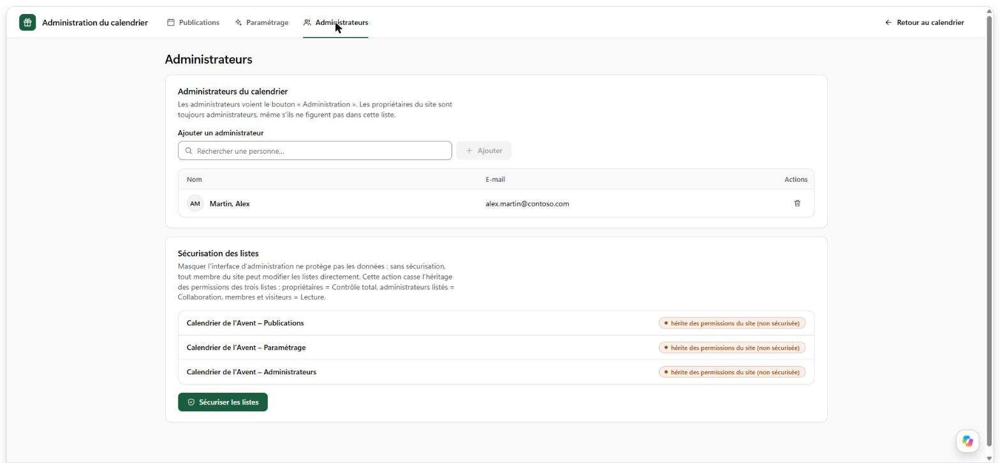

1. Dans **Ajouter un administrateur**, saisissez au moins 2 caractères, choisissez la personne, puis **Ajouter**.
2. Pour retirer quelqu'un, utilisez l'icône de corbeille de la colonne *Actions* et confirmez.

### Sécuriser les listes

Masquer l'écran d'administration ne protège **pas** les données : tant que les listes héritent des permissions du site, tout membre peut modifier publications, profils et administrateurs directement dans SharePoint ou par l'API.

L'encart **Sécurisation des listes** indique l'état des trois listes de contenu (*permissions spécifiques (sécurisée)* ou *hérite des permissions du site (non sécurisée)*). **Sécuriser les listes** (réservé aux propriétaires du site) casse l'héritage des permissions des listes `AdventPublications`, `AdventSettings` et `AdventAdmins`, puis applique :

| Qui | Niveau d'autorisation |
|---|---|
| Groupe des propriétaires du site | Contrôle total |
| Administrateurs listés | Collaboration |
| Groupes des membres et des visiteurs du site | Lecture |
| Tout autre groupe ayant accès | Lecture |
| Autres utilisateurs ayant des droits directs | Retirés |

La personne qui applique la sécurisation garde son accès direct. La liste des consultations n'est jamais concernée par ce bouton (elle a sa propre sécurité au niveau des éléments, voir la [section 8](#8-suivi-des-consultations-et-vie-privée)). Pour revenir en arrière, rétablissez l'héritage dans les paramètres de chaque liste.

**Resynchronisation.** Quand les listes sont sécurisées et qu'un **propriétaire du site** ajoute ou retire un administrateur, les droits sont mis à jour automatiquement (« Les permissions des listes ont été mises à jour. »). Quand c'est un administrateur listé non propriétaire, les listes gardent leurs droits précédents et un message demande à un propriétaire de cliquer sur **Réappliquer les permissions**.

**Bonnes pratiques**

- Sécurisez les listes juste après l'installation, puis ajoutez les administrateurs.
- Confiez la rédaction à des administrateurs listés et gardez un groupe *Propriétaires* restreint.
- Cliquez sur **Réappliquer les permissions** après une modification des groupes du site ou si quelqu'un a reçu des droits directs sur les listes.

## 6. Profils de thème

Un profil de thème personnalise **uniquement le calendrier** (sapin ou grille, couleurs de la pop-up, logo). L'écran d'administration et la barre du haut gardent leur style neutre. Les profils sont enregistrés dans la liste `AdventSettings`.

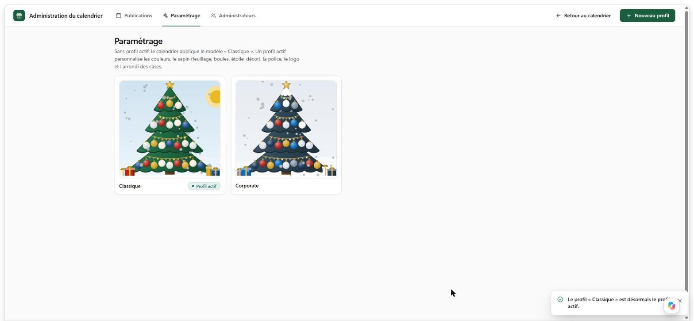

### Créer un profil à partir d'un modèle

1. **Administration › Paramétrage › Nouveau profil**.
2. Choisissez l'un des 6 modèles :

   | Modèle | Ambiance |
   |---|---|
   | Classique | Vert sapin, rouge baie et or sous un ciel d'hiver (thème par défaut) |
   | Nordique | Blanc, bleu glacier et argent dans un paysage enneigé |
   | Nuit étoilée | Bleu nuit, lune et étoiles, boules dorées |
   | Givré pastel | Rose poudré, menthe et lavande |
   | Corporate | Neutre et sobre, sans neige : à recolorer aux couleurs de votre entreprise |
   | Chalet | Bordeaux, bois et crème, décor de soirée |

   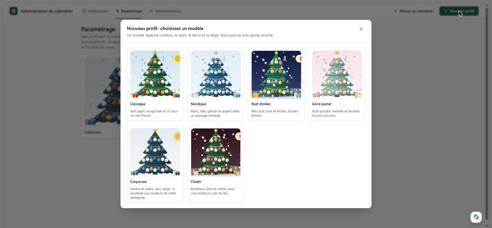

3. Ajustez le profil (**Aperçu** en direct à droite), puis **Enregistrer**.
4. Cliquez sur **Définir comme actif**. Un seul profil est actif à la fois. Sans profil actif, le modèle *Classique* s'applique.

**Appliquer un modèle** (section *Sapin* d'un profil existant) remplace les couleurs et les réglages du sapin, et conserve le nom, le titre, le logo et la police.

### Ce que vous pouvez personnaliser

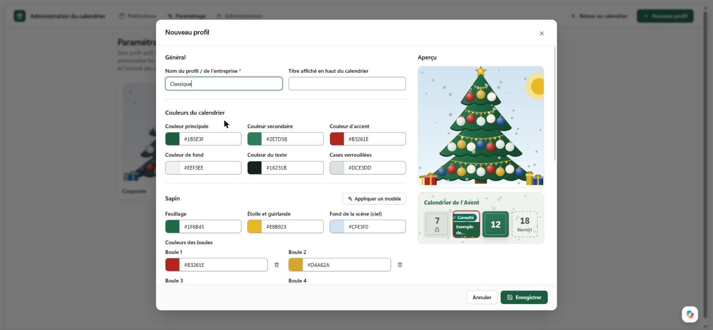

| Section | Réglages |
|---|---|
| **Général** | *Nom du profil / de l'entreprise* ; *Titre affiché en haut du calendrier* (barre du haut ; par défaut « Calendrier de l'Avent *année* ») |
| **Couleurs du calendrier** | Principale, secondaire, accent, fond, texte, cases verrouillées (`#RRGGBB`, sélecteur de couleur). Les textes posés sur ces couleurs sont recalculés automatiquement pour rester lisibles |
| **Sapin** | Feuillage ; Étoile et guirlande ; Fond de la scène (ciel) ; Couleurs des boules (de 3 à 6, utilisées à tour de rôle sur les 24 boules) ; Décor (*Jour*, *Neige*, *Nuit*) ; Guirlande lumineuse (lumières qui scintillent) |
| **Typographie et forme** | *Police (font-family CSS)* ; *Arrondi des cases* (de 0 à 32 px) ; *URL du fichier de police (optionnel)* |
| **Logo et animation** | *Logo* (URL, ou **Téléverser** dans *Ressources du site › AdventCalendar*) ; *Animation de neige* |

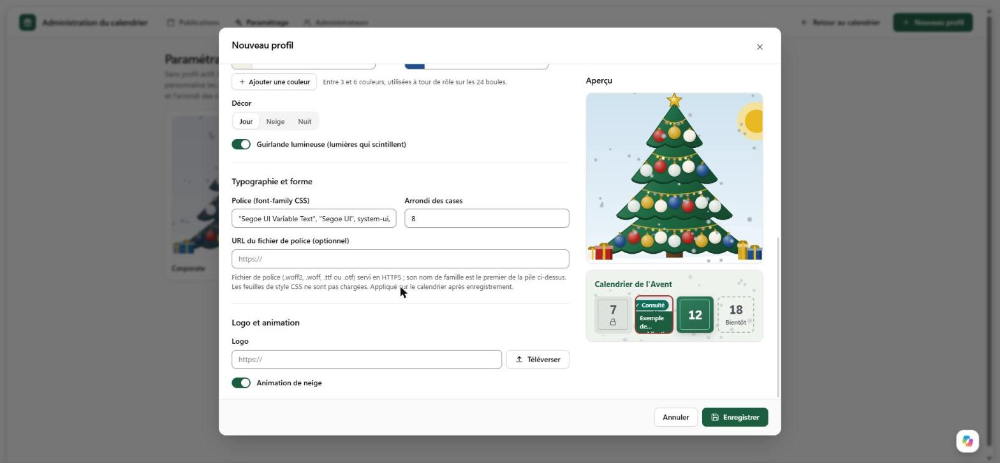

**Police.** Gardez la pile de polices système, ou indiquez une police déjà installée sur les postes. Pour charger une police web, indiquez l'URL HTTPS d'un **fichier** de police (`.woff2`, `.woff`, `.ttf` ou `.otf`) et placez son nom de famille **en premier** dans le champ *Police*. Les feuilles de style CSS (comme les URL des services de polices web) sont refusées pour des raisons de sécurité. La police s'applique au calendrier une fois le profil enregistré.

**Logo.** Affiché dans le bloc de titre du sapin et dans l'en-tête de la grille. Utilisez une image accessible à vos lecteurs (par exemple dans les Ressources du site).

### Imposer un profil à un web part

La propriété **Profil de thème** du web part remplace le profil actif pour ce seul web part (voir la [section 7](#7-propriétés-du-web-part)). Si le profil imposé est supprimé, le profil actif s'applique de nouveau.

Supprimer un profil le place dans la corbeille du site.

## 7. Propriétés du web part

Modifiez la page, sélectionnez le web part et ouvrez ses propriétés.

| Groupe | Propriété | Valeurs | Effet |
|---|---|---|---|
| Affichage | **Présentation** | *Sapin* (par défaut), *Grille de portes* | Présentation des 24 cases |
| Affichage | **Édition (année)** | Vide, ou de 2000 à 2100 | Seules les publications de cette année sont affichées. Vide = édition automatique : l'année en cours en novembre et décembre, l'année précédente de janvier à octobre (voir [L'année suivante](#10-lannée-suivante)) |
| Affichage | **Profil de thème** | *Profil actif (par défaut)* ou le nom d'un profil | Impose un profil à ce web part |
| Mode test | **Mode test : simuler la date du jour** | Oui / Non | Active la date simulée |
| Mode test | **Date simulée** | `AAAA-MM-JJ` | Date utilisée à la place de la date du jour |

Le **mode test** ne s'applique que lorsque la **page est en mode édition**, avec un bandeau « Mode test actif… ». Les lecteurs voient toujours la date réelle. Pour prévisualiser toutes les cases, utilisez `AAAA-12-24`. Quand *Édition (année)* est vide, l'édition automatique est calculée à partir de la date simulée (même règle : une date de novembre ou de décembre affiche cette année, une date de janvier à octobre affiche l'année précédente).

## 8. Suivi des consultations et vie privée

Quand un lecteur ouvre une case, l'application l'enregistre dans la liste `AdventViews` : **une ligne par utilisateur et par édition**, avec les jours ouverts et la date de leur première ouverture (JSON dans `AdvViewedDays`), le nombre de jours ouverts (`AdvViewedCount`), l'utilisateur (*Créé par*) et la dernière consultation (*Modifié*). Les badges « Consulté » et les compteurs de la légende viennent de cette liste : ils suivent le lecteur sur tous ses appareils.

- Si la liste ne peut pas être lue, le calendrier se replie sur les cases mémorisées dans le navigateur et affiche un avertissement avec un bouton **Réessayer**.
- Si une consultation ne peut pas être enregistrée, la case n'est pas marquée « Consulté » et un avertissement s'affiche.
- Les cases du contenu de démonstration intégré ne sont pas enregistrées dans la liste.

**Sécurité au niveau des éléments.** Chacun ne lit et ne modifie que ses propres lignes (réglages de la liste : lecture et modification limitées aux éléments créés par l'utilisateur). Les pièces jointes sont désactivées.

**Vie privée (RGPD).** Cette liste contient des données personnelles : qui a ouvert quelle case, et quand. Les propriétaires du site (Contrôle total) et les administrateurs de la collection de sites peuvent lire toutes les lignes. Informez vos collaborateurs conformément à votre politique de protection des données, fixez une durée de conservation et supprimez les lignes des éditions passées quand elles ne servent plus.

## 9. Langues

L'interface, les formats de date et le contenu de démonstration sont en **français** ou en **anglais** :

- les utilisateurs dont la langue d'affichage SharePoint est **`fr-FR`** ont l'interface en français ;
- **toutes les autres langues** reçoivent l'anglais, y compris `fr-CA` et `fr-BE`. Pour les prendre en charge, un développeur peut ajouter un fichier de libellés, par exemple `loc/fr-ca.js` (copie de `fr-fr.js` avec la valeur `UiLocale` adaptée).

La langue d'affichage SharePoint est la langue préférée de l'utilisateur, **si le site la propose** :

- **Utilisateur** : il choisit sa langue préférée dans les paramètres de son compte Microsoft 365 (ou dans son profil SharePoint, *Langue et région*). La prise en compte peut demander un certain temps.
- **Site** : un propriétaire l'active dans **Paramètres du site › Paramètres de langue** (langue par défaut du site ou langue secondaire).

**Les titres des listes et les noms des colonnes** suivent la même langue d'affichage, grâce aux titres multilingues SharePoint : anglais pour `en-US`, français pour `fr-FR` (voir [Ajouter l'application au site](#ajouter-lapplication-au-site)). Ils sont posés la première fois qu'un propriétaire du site affiche la page, et un titre renommé par un administrateur est conservé tel quel. Comme l'interface, ils ne changent de langue que si le site propose la langue de l'utilisateur.

Le contenu de démonstration importé dans la liste garde la langue de l'administrateur qui l'a importé.

## 10. L'année suivante

- **Édition (année) vide** (par défaut) : le calendrier affiche **l'année en cours en novembre et en décembre**, et **l'année précédente de janvier à octobre**. Après Noël, le calendrier qui vient de se terminer reste donc consultable jusqu'à fin octobre, toutes cases ouvertes ; le **1er novembre**, il passe à la nouvelle édition, dont les cases s'ouvrent à partir du 1er décembre. Si la nouvelle édition n'a encore aucune publication publiée, les lecteurs voient le contenu de démonstration (cases verrouillées jusqu'à leur date).
- **Année fixe** : renseignez *Édition (année)* pour garder une édition donnée sur la page toute l'année. Elle s'applique aux lecteurs et à l'année proposée par défaut dans l'administration.
- **Préparer l'édition suivante à l'avance** : à partir de **septembre**, **Administration › Publications** s'ouvre directement sur l'édition à venir (année en cours) ; plus tôt dans l'année, choisissez-la dans le sélecteur **Année**. Créez les publications en brouillon et publiez-les avant le 1er décembre (les brouillons ne remplacent pas le contenu de démonstration, voir [Contenu de démonstration intégré](#contenu-de-démonstration-intégré)), ou importez le contenu de démonstration pour cette année (publications créées publiées). Les publications de chaque édition sont conservées dans la même liste (`AdvYear`).
- **Réutiliser le contenu précédent** : il n'existe pas de fonction de copie. Créez les nouvelles publications dans l'administration (en copiant le texte de l'an passé) ou réimportez le contenu de démonstration. Ne modifiez pas `AdvYear` directement dans la liste : la clé masquée `AdvKey` (année-jour) ne correspondrait plus.
- **Les consultations** sont suivies par édition : chaque lecteur repart sans aucune case ouverte.

## 11. Dépannage

| Symptôme | Cause et solution |
|---|---|
| « Les listes du calendrier sont absentes ou incomplètes sur ce site… » | L'application n'est pas ajoutée au site, ou une liste ou une colonne obligatoire a été supprimée. Ajoutez l'application (*Contenu du site › Nouveau › Application*), ou demandez à un propriétaire d'afficher la page : les éléments manquants sont créés automatiquement |
| « Certains réglages des listes n'ont pas pu être appliqués (non bloquant) : » | L'utilisateur n'avait pas *Gérer les listes* ou *Gérer les autorisations* (par exemple un membre au niveau *Modification*), ou SharePoint a refusé une traduction de titre. Un propriétaire affiche la page dans une nouvelle session de navigateur (la vérification a lieu une fois par session) |
| Pas de bouton **Administration** | L'utilisateur n'est ni propriétaire du site ni administrateur listé, ou les listes sont absentes |
| « La sécurisation des listes est réservée aux propriétaires du site. » | Seul un propriétaire peut sécuriser les listes |
| « Les listes sont sécurisées : un propriétaire du site doit cliquer sur « Réappliquer les permissions »… » | Un administrateur non propriétaire a modifié les administrateurs ; un propriétaire clique sur **Réappliquer les permissions** |
| « {n} illustrations n'ont pas pu être copiées dans Ressources du site… » après l'import | Les illustrations sont téléchargées depuis les fichiers de l'application avant d'être copiées. Si le CDN Office 365 (public ou privé) les sert sans en-têtes d'accès multi-origine, ou si l'utilisateur ne peut pas écrire dans les Ressources du site, les publications sont créées sans image. Déposez les fichiers SVG de `src/webparts/adventCalendar/assets/demo` dans *Ressources du site › AdventCalendarDemo* et renseignez l'image de chaque publication, ou vérifiez la configuration du CDN |
| La police du profil ne s'applique pas | L'URL doit être en HTTPS et se terminer par `.woff2`, `.woff`, `.ttf` ou `.otf` ; le serveur doit autoriser les requêtes multi-origines ; le nom de famille doit être le premier du champ *Police* ; enregistrez le profil |
| L'enregistrement d'un profil échoue sur un site mis à jour depuis une ancienne version | Les nouvelles colonnes ne sont pas encore créées : un propriétaire affiche d'abord la page |
| Toutes les cases sont verrouillées | Les dates d'ouverture ne sont pas atteintes. Vérifiez la propriété *Édition (année)*, ou utilisez le mode test (page en mode édition) |
| Le mode test n'a aucun effet | Il ne s'applique qu'en mode édition, avec une date valide au format `AAAA-MM-JJ` |
| Le badge « Consulté » n'apparaît pas | Le contenu de démonstration n'est pas enregistré dans la liste ; sinon, lisez l'avertissement affiché au-dessus du calendrier |
| La barre SharePoint du haut a disparu | Plein écran du mode lecture. Ajoutez `?chrome=1` à l'adresse de la page, ou passez la page en mode édition |
| Le mauvais thème s'affiche | La propriété *Profil de thème* impose un profil à ce web part ; remettez *Profil actif (par défaut)* |
| L'interface est en anglais pour un utilisateur francophone | Sa langue d'affichage n'est pas `fr-FR` (voir [Langues](#9-langues)) |
| Les titres des listes ou des colonnes sont en français pour un utilisateur anglophone | Les titres sont traduits la première fois qu'un propriétaire du site affiche la page ; le site doit proposer la langue de l'utilisateur (*Paramètres du site › Paramètres de langue*) ; un titre renommé par un administrateur n'est jamais traduit. Tout échec figure dans le message « Certains réglages des listes n'ont pas pu être appliqués » |

## 12. FAQ

**Peut-on avoir plusieurs calendriers sur un même site ?**
Tous les web parts d'un site partagent les quatre mêmes listes. Vous pouvez afficher des éditions (*Édition (année)*) ou des thèmes (*Profil de thème*) différents, mais des contenus distincts demandent des sites distincts.

**Peut-on cacher le contenu d'une case jusqu'à sa date ?**
Non. Le verrouillage est visuel : les publications restent lisibles par l'API REST. Gardez les contenus sensibles hors du calendrier.

**Peut-on intégrer une vidéo ?**
Non, les iframes sont retirées par sécurité. Ajoutez un lien vers la vidéo (*Lien « En savoir plus »* ou lien dans le texte).

**Qui peut voir qui a ouvert quelle case ?**
Chacun ne voit que ses propres lignes. Les propriétaires du site et les administrateurs de la collection de sites peuvent lire toute la liste des consultations.

**L'application demande-t-elle des permissions d'API ou des scripts personnalisés ?**
Non. Le package ne demande aucune permission d'API et ne nécessite pas d'autoriser les scripts personnalisés sur le site.

**Comment mettre à jour l'application ?**
Déposez le nouveau `.sppkg` dans le catalogue d'applications pour remplacer l'ancienne version. Si le *Contenu du site* propose une mise à jour de l'application, appliquez-la. Les évolutions de schéma sont appliquées par le web part lui-même la première fois qu'un propriétaire affiche la page.

**Comment retirer l'application ?**
Supprimez-la du *Contenu du site*. Les quatre listes et les dossiers des Ressources du site peuvent subsister : supprimez-les à la main s'ils ne servent plus.

**L'application est-elle accessible ?**
Les cases et les boules sont des boutons avec des libellés explicites, le focus clavier est toujours visible, les boîtes de dialogue retiennent le focus, aucune information ne repose sur la seule couleur, et les animations s'arrêtent quand l'appareil demande à réduire les mouvements.

---

## Auteur

Conçu et développé par **MARZAQ Ahmed**, consultant SharePoint, Microsoft 365 et SharePoint Framework (SPFx).

- Site : [marzaqconsulting.fr](https://marzaqconsulting.fr/)
- LinkedIn : [Ahmed MARZAQ](https://www.linkedin.com/in/ahmed-marzaq-519221155/)

Publié sous [licence MIT](../LICENSE).
